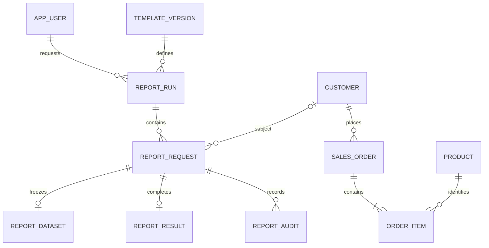

# Reporting database design and viva notes

The sales facts are the graded relational core. The application computes reports through SQL, retains their historical content, and uses Conduit to schedule preparation and rendering. UI redesign is a later phase.

## Base facts and normalization

An unnormalized sales record would repeat customer details and contain a list of products inside each order. First normal form separates each product line into its own row. A flat line table would still repeat order/customer/product metadata. The final decomposition separates these dependencies:

| Relation | Candidate identity and dependencies |
|---|---|
| customer | customer_id -> customer_ref, full_name, email, region; customer_ref and email are unique alternate keys |
| product | product_id -> SKU, product_name, category, catalogue_price; SKU is an alternate key |
| sales_order | order_id -> order_ref, customer_id, ordered_at, status; order_ref is an alternate key |
| order_item | (order_id, line_number) -> product_id, quantity, unit_price |

Second normal form removes attributes dependent only on the order portion of the line key, such as order date/customer. Third normal form removes transitive customer and product descriptions from orders/lines into their own relations. The historical unit_price belongs to the sale line: the same product can sell at different prices at different times, so today's catalogue price does not determine that historical value.

Line totals are calculated as quantity * unit_price in v_sales_lines rather than retained as an independent authoritative value. The initial migration used a generated column; migration 110 removes it and defines the final normalized fact structure. Money uses NUMERIC rather than floating-point arithmetic in SQL. Date intervals are start-inclusive, end-exclusive.

These dependency claims describe the four base relations. Frozen JSON datasets and materialized aggregates are explicitly derived reporting artifacts; no blanket BCNF claim is made for the entire broker/reporting schema.

## Relationships

Application rules create order lines and report artifacts through their workflows; a database FK alone does not require every order to have a line or every request to have completed. The queue correlates preparation jobs by run UUID and rendering jobs by request UUID. Those UUIDs are payload/key correlations, not invented global broker message IDs or asserted foreign keys to partitioned messages.

## Reporting records

template_version contains approved SQL text and immutable version identities. report_run holds typed parameters, requester and an idempotent submission identity. report_request identifies each subject within a run. report_dataset freezes the detail values consumed by the renderer. report_result is unique per request and records relative artifact paths/checksums. report_audit records state transitions through triggers. This is content replay, not PostgreSQL time travel.

Submission uses CALL reporting.submit_run inside a caller transaction; the request and preparation message commit together. Data preparation uses a consistent transaction and commits before rendering. Rendering jobs are enqueued in bounded chunks, coordinated through an advisory lock to avoid inconsistent partition lock order. Workers read the saved dataset and publish actual CSV/HTML files. Result insertion and queue acknowledgement share one database transaction. File writes themselves are outside PostgreSQL rollback; stable output identities and repeat-safe publication handle replayed work.

The reporting interface uses username/password sign-in. reporting.web_account stores unique usernames, salted password hashes and enabled state; reporting.web_session references an account by FK and stores a hash of each random session token with creation/expiry timestamps and an expiry index. Lookup joins account/session records and checks account state plus expiration. Logout deletes the session, and account deletion cascades to its sessions. These are separate from the broker application identities.

The reporting API accepts these administrator sessions or the existing developer bearer token. It remains a local trusted demonstration service, not a claim of hostile multi-tenant isolation for the direct-DB SDK. Broker integration controls are absent from the demonstration navigation, while its internal queue still schedules the reporting workflow.

## Queries to explain

v_sales_lines contains the four-table JOIN. Approved templates use date predicates, GROUP BY, SUM, ranking and running-total window functions. db/evidence/reporting_review.sql adds HAVING, NOT EXISTS, CRUD, procedure/rollback, index plans, materialized-view refresh and trigger evidence. The same runner captures SQL and actual outputs in artifacts/dbms-evidence.txt.

The report_run preparation state and request processing state answer different questions. v_run_progress counts mutually exclusive request states. A retry increments attempts but does not create a second expected business report. The existing queue's shared delivery model is competing work, not subscriber fan-out.
