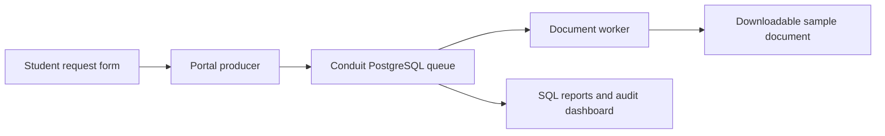

# Conduit demonstration scenario research

Date: 13 October 2026. The project remains a DBMS-backed message broker. This document recommends a demonstration application around it, without changing the implementation, schema, or queries. Recommendations below are design judgments, not claims that the proposed application already exists.

Follow-up: the user requested broader real application options. See [REAL_APPLICATION_DEMO_OPTIONS.md](REAL_APPLICATION_DEMO_OPTIONS.md) for the newer comparison of e-commerce and three alternatives, plus concrete Review 2 SQL evidence. The campus recommendation below records the earlier proposal; no scenario has yet been selected or implemented.

## Recommendation

Demonstrate **campus document request processing** using Conduit. A student submits a request for a sample bonafide certificate or enrolment report. The portal stores a job in Conduit and returns a request identifier. A separately running worker generates a downloadable sample document. Faculty can see the request, stored message, processing attempt, actual output, and audit trail.

Suggested presentation description: **Conduit is a DBMS-backed message management system demonstrated through asynchronous campus document processing.** Keep Conduit as the project name and its broker architecture as the core. The campus application explains what the broker enables.

The minimum demonstration uses one topic and one worker group with two worker processes. Avoid making the initial scenario depend on multiple services each receiving a copy of one event: current runtime probes confirm that groups share global message delivery state.

## What the sources establish

1. A queue can buffer requests so intake and downstream processing run independently. Worker unavailability does not immediately prevent submission while the queue remains available. This supports the visible demonstration of accepting document requests with workers stopped. It is the established queue-based load-leveling pattern, rather than an invented project justification. [Microsoft queue-based load leveling](https://learn.microsoft.com/en-us/azure/architecture/patterns/queue-based-load-leveling).

2. Multiple worker instances can compete for jobs on one queue. This fits Conduit's current model and lets the demonstration show two workers claiming separate requests. Do not promise strict processing order or universally faster throughput. [Microsoft competing consumers](https://learn.microsoft.com/en-us/azure/architecture/patterns/competing-consumers).

3. A web frontend, queue, and background worker form a recognized application architecture. The proposed student portal and document worker are concrete roles in that pattern. They do not need to become a complete university administration system. [Microsoft web-queue-worker architecture](https://learn.microsoft.com/en-us/azure/architecture/guide/architecture-styles/web-queue-worker).

4. PostgreSQL-backed queues are an established implementation choice. PGMQ documents SQL queue creation, JSON message publication, reading, visibility timeouts, and archival. This supports the legitimacy of the project direction; PGMQ's particular guarantees do not automatically apply to Conduit. [PGMQ documentation](https://pgmq.github.io/pgmq/latest/).

5. Visibility timeouts support recovery when a consumer fails to finish a job. In Conduit, an expired claim also requires its reaper function to run. Present that implementation explicitly rather than implying timeout automatically resets the row. [Amazon SQS visibility timeout](https://docs.aws.amazon.com/AWSSimpleQueueService/latest/SQSDeveloperGuide/sqs-visibility-timeout.html).

6. Dead letter queues collect repeatedly unsuccessful messages for diagnosis and possible redrive. A well-formed request referring to an unavailable student record gives a comprehensible demonstration failure. Do not confuse a payload rejected before insertion with a job that was accepted and subsequently failed. [Amazon SQS dead letter queues](https://docs.aws.amazon.com/AWSSimpleQueueService/latest/SQSDeveloperGuide/sqs-dead-letter-queues.html).

7. PostgreSQL documents SKIP LOCKED as suitable for avoiding row-lock contention in queue-like consumers. It skips conflicting row locks rather than eliminating locking. Use this to explain the implemented claiming SQL after the faculty understands the request workflow. [PostgreSQL SELECT locking](https://www.postgresql.org/docs/16/sql-select.html).

## Scenario comparison

This comparison is our assessment of demonstration suitability, not a measured benchmark or institutional requirement.

| Scenario | What the audience sees | Fit with current queue | Main consideration |
|---|---|---|---|
| Campus document requests | Student request becomes a downloadable sample certificate/report | Strong: each request is an independent worker job | Needs a real output-generating worker, but has no external service dependency |
| Online-shop packing slips | Order creates a downloadable packing slip through a warehouse worker | Strong: reuse the existing orders example | Less new fixture work, but broader order/payment expectations can distract |
| Campus notification delivery | Announcement creates a separate delivery job per recipient/channel | Strong if each delivery is its own queued job | Real email requires external setup; a local inbox must be honestly described as a simulation |
| Ticket booking and payment | Reservation and payment status change asynchronously | Weak for a small initial demonstration | Overselling, expiry, compensation, and payment correctness invite much larger requirements |

Campus document requests are my first choice because faculty can recognize the task immediately, output is tangible, and failures are easy to explain. Packing slips are the lowest-rework alternative because the seed already includes order messages. Notification delivery is also reasonable if the user prefers a communication-oriented scenario.

## The faculty's first minute

Lead with the task, not the schema or broker vocabulary:

“Students can request a document without waiting for the document generator to finish. Conduit stores each request in PostgreSQL. A worker processes it later. If that worker stops, the request stays in the queue. We can inspect, retry, and audit the request through SQL.”

Then show the architecture:



This is a proposed architecture. The existing repository has the broker, API, SDK, and operational dashboard. It does not yet contain this portal, worker, or document output flow.

Keep the terms grounded:

| Broker term | Meaning in the demonstration |
|---|---|
| Producer | Student portal submitting a document-generation job |
| Topic | `document-requests`, a named destination for those jobs |
| Message | The JSON instruction containing request ID, student ID, and document type |
| Consumer/worker | A separate process that generates the document |
| Consumer group | `document-workers`, the worker pool processing the queue |
| Pending | Request stored and waiting for a worker |
| Claimed | A worker has taken responsibility for an attempt |
| Delivered | Worker acknowledged successful processing; explain this operational meaning |
| Dead letter | Job repeatedly failed and needs attention |
| Producer sequence | Identity used to recognize a retry of the same submission |
| Audit record | Database evidence of a recorded broker action |

Do not translate `delivered` into “student downloaded it.” That is a different business event.

## Trace one understandable request

Proposed payload:

```json
{
  "request_id": "DOC-1042",
  "student_id": "DEMO-S017",
  "document_type": "bonafide"
}
```

Use fictional student records and visibly mark outputs as demonstration documents. The faculty follows `DOC-1042` through every screen, SQL result, worker log, and final download.

The normal flow is submission, queued message, worker claim, document generation, recorded result, acknowledgement, and a visible download. The worker must perform the output operation; a button that merely changes a message to delivered does not demonstrate application processing.

Keep the portal and worker separately controllable. Stopping the worker, while PostgreSQL and the portal remain running, makes the reason for the queue visible. Stopping the database itself would prevent the producer from storing new jobs and demonstrates a different failure mode.

## Proposed seven-minute demonstration

This timing is a recommendation, not a rule from the assessment. Shorten or expand it to the actual review slot.

| Time | Action | Faculty-visible result | Database evidence |
|---|---|---|---|
| 0:00–0:45 | Explain the student request and three components | Portal, Conduit, and worker have distinct responsibilities | Small architecture diagram |
| 0:45–1:45 | Submit DOC-1042 while worker is stopped | Request accepted and waiting; no output yet | Message row, ledger row, required fields, producer audit |
| 1:45–2:45 | Start worker and process the request | Downloadable sample document appears | Claim/ack states, recorded result, delivery audit |
| 2:45–3:30 | Repeat the same producer submission identity | No extra queued job from the retry | Same location and one ledger identity |
| 3:30–4:15 | Submit a small batch and start two workers | Workers take separate jobs | SKIP LOCKED query and distinct claimed locations |
| 4:15–5:15 | Claim a job and stop that worker before completion | Claim expires; reaper makes it available; another worker finishes | Visibility deadline, attempt counter, recovery function |
| 5:15–6:00 | Process a valid-shaped job referencing an unavailable record | Repeated failure reaches DLQ with a clear reason | DLQ payload, attempts, reason, and requeue operation |
| 6:00–7:00 | Show compact SQL evidence and rubric matrix | Counts, joins, constraints, and audit explain the implementation | Actual result rows, one trigger effect, and index definition |

For a very short slot, keep the stopped-worker submission, successful output, duplicate submission, and SQL evidence. Move concurrency, timeout recovery, and DLQ to questions or recorded supplementary demonstrations.

## Exact grading mapping

| Review 2 requirement | Evidence in the proposed scenario |
|---|---|
| Database implementation and constraints | Existing broker ER model and actual PK/FK/UNIQUE/CHECK definitions; required-field contract for document jobs |
| Data insertion and management | Submit job, query stored row, claim/ack, retry, requeue failed job, demonstrate a safe management action |
| Queries, filtering, aggregation, joins | Pending requests, counts by state/topic, application-to-message join, audit actor join, failure counts and processing reports |
| Advanced features | Existing SQL functions, triggers, transactions, partial indexes, RLS comparison, views and optional materialized result |
| Presentation | One familiar story, actual output, readable SQL/result pairs, and honest failure demonstrations |

For Review 3, the same scenario supplies an executable end-to-end demonstration and expected results. Capture these in the final report and rehearse why each step behaves as it does.

The broker already has sufficient relational material to support the categories. Adding student tables merely to inflate the table count would not improve the demonstration. Add only records needed by a real workflow, such as a document request and its generated result; the exact data model should follow scenario agreement.

## Design decisions to finalize before implementation

1. Select document requests, packing slips, or notification deliveries as the main story.
2. Select one tangible output and define what counts as successful processing.
3. Define one normal request, one recoverable worker failure, and one persistent business failure.
4. Select the visible screens: submission, request/output status, and broker evidence.
5. Decide where result records live and how repeated processing avoids duplicate results. Producer dedupe alone does not prevent repeated worker effects after a crash.
6. Agree on the required SQL/result pairs, then adjust data and queries only to support those facts.

Keep message ingestion, claiming, and settlement inside Conduit. The added worker should call its existing interface where appropriate. Any new transaction API or result uniqueness constraint should have a concrete purpose and test.

## Implementation order after agreement

First correct the runtime defects confirmed in [the execution report](RUNTIME_VERIFICATION.md). Then build the smallest real producer/worker/output path, using an isolated reproducible demo dataset. Add failure controls, targeted correctness checks, and grading queries. Finally build the slides around the working demonstration.

Do not begin by changing the visual theme, enlarging the schema, or adding more benchmark slides. The faculty's current difficulty is recognizing the application behavior and the role of the database.
