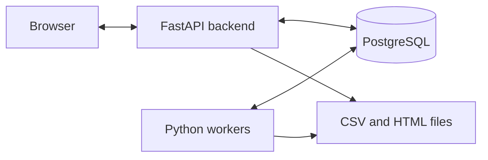
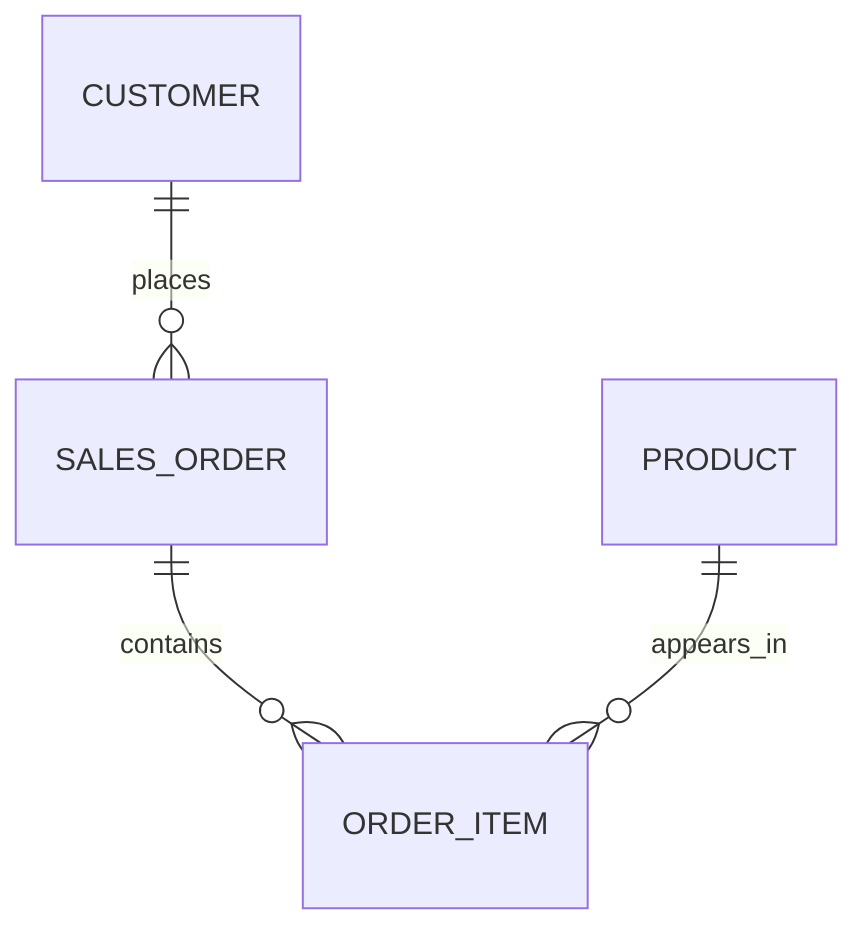

# Conduit evaluator discussion and viva study notes

Started: 17 October 2026.

Format: the student explains one section, the evaluator cross-questions it, and the discussion stays there until the evaluator is satisfied. Record questions and answers in chronological order within each section. Do not advance automatically. On 18 October 2026 the user explicitly requested all remaining sections together; Exchange 12 therefore covers Sections 8–11 in one response.

Guideline: `C:\Users\asus\Downloads\Guidelines for BCSE302P.docx`. The user's latest marking allocation is PPT 5, demo/implementation 5, viva 5, novelty 2, report 3. The document supplies the required contents, not that numerical allocation.

## Section 1 — Abstract, problem statement and basic idea

### Exchange 1 — Student's opening explanation

Good morning, Professor. Our project is “Conduit: An Asynchronous Business Reporting System.”

Consider a retailer that maintains customer details, products, orders, and order items in a database. A manager needs reports such as a customer's purchases during a particular period, products generating the highest sales, and monthly sales totals. Generating these reports requires joining related tables, filtering records, and calculating aggregates.

Our problem has two parts.

First, report generation needs to remain manageable when the workload grows. Generating one statement is straightforward, but requesting separate statements for 10,000 customers involves database work and file generation. The manager should be able to submit the request and track progress while processing continues in the background.

Second, historical reports need to remain explainable. If someone corrects an order after a report was generated, rerunning its query may produce different figures. We need to preserve the data behind the original report.

Our project records the request, uses SQL to calculate the report data, saves that dataset, and generates downloadable reports through background workers. Each output can be inspected alongside its query, parameters, and processing history.

The application's purpose is reliable business reporting. The PostgreSQL-backed queue developed in Review 1 is the internal mechanism that schedules that work.

### Exchange 2 — Evaluator's questions

> Q1: Why is this called Asynchronous, we cant a synchrnours system do what you are doing.
>
> Second, historical reports need to remain explainable. If someone corrects an order after a report was generated, rerunning its query may produce different figures. We need to preserve the data behind the original report
>
> What do u mean by this can u explain with a scenario? Are you making an audit log? What will Happen if something changes will u regenerate the entire report?
>
> Answer these qustions for now. Also create a file where u save your responses and my questions in order for me to refer later. section by section

### Student's answer — Q1: asynchronous versus synchronous

Yes, Professor. A synchronous system can calculate and generate the same reports. We call ours asynchronous because submitting the request and finishing the report happen separately.

In a synchronous design, clicking Generate keeps the HTTP request waiting while the application reads the database, calculates the report and writes its output. The response returns when generation finishes.

In our asynchronous design, clicking Generate records the request and queues the work in PostgreSQL. The application returns a run reference and progress page before report completion. A separately running worker prepares the dataset and generates the files. The user can check status and download the completed result later. The browser polls for progress; it does not receive the final file immediately after submission.

For one small report, synchronous processing may be simpler and entirely sufficient. For a batch of 10,000 statements, separating submission from completion avoids holding one browser request open for the whole batch and lets a bounded worker pool process persisted work. If a worker stops, accepted work remains recorded; processing can resume through the recovery mechanism.

Asynchronous does not mean the database runs no synchronous queries, that the report appears instantly, or that it must generate faster. SQL statements and file writes still take time inside the workers. The distinction is the request lifecycle: accepted now, completed later. Multiple workers are a separate concurrency choice.

Historical snapshots and replay are independent of asynchronous processing. A synchronous reporting application could implement them too; our project combines the two features for different purposes.

### Student's answer — Q2: historical reports, audit and regeneration

Consider this illustrative customer statement. These numbers explain the behavior; they are not a claim about a particular current UI customer's records.

At 10:00, Report A's dataset is captured:

| Item | Quantity | Sale-time unit price | Line total |
|---|---:|---:|---:|
| Keyboard | 2 | 500 | 1,000 |
| Mouse | 1 | 200 | 200 |
| **Total** | | | **1,200** |

We save the calculated report rows, including the detail values and total, in reporting.report_dataset. We retain the template version and date parameters through the related request/run records. The capture occurs during worker preparation; it is not necessarily the instant the user clicked Generate.

At 10:15, someone corrects the keyboard's sale-time unit_price on the original order line from 500 to 550. The current source calculation is now (2 × 550) + 200 = 1,300.

The existing Report A continues to show 1,200 because it represents the dataset captured at 10:00. It does not silently become a different report after the source correction. This preserves what was reported then; it does not claim that the old value was the corrected business truth.

The three relevant actions are:

| Action | Data used | Outcome in this example |
|---|---|---|
| Download Report A | Its existing generated file | Original output: 1,200 |
| Replay Report A | Its retained dataset | Reconstructed historical content: 1,200 |
| Submit a fresh Report B for the same customer and period | Current source data captured during B's preparation | Corrected output: 1,300 |

Report B receives a new run/request identity. Report A is not overwritten. Replay reconstructs historical content from saved rows; it does not rerun the original query against today's sales tables.

This is distinct from an audit log. Our reporting.report_audit records report-processing state changes, such as queued → processing → completed. Its triggers do not provide a complete before/after history of every edit to the sales tables. The retained dataset answers “what values were used in this report?” A full source-change audit would additionally answer “who changed this order field, from what value to what value, and when?” That additional source-edit audit is not implemented.

Changes do not automatically regenerate old reports. To obtain corrected figures, the manager explicitly submits a fresh report. For a single affected customer, a fresh single-customer statement is available. If the manager requests a fresh full batch, the current implementation prepares that full batch again. Automatic change detection and incremental regeneration of only affected reports are not implemented.

The catalogue price and the sale-time price are separate. Updating today's product.catalogue_price alone does not change past purchase totals: reports use order_item.unit_price. The scenario above deliberately corrects the sale-time order-line price.

### Implementation anchors

- Submission: `reporting/service.py::submit` and `reporting.submit_run`.
- Independent worker preparation/rendering: `reporting/worker.py::prepare`, `render`, `tick`.
- Consistent preparation: REPEATABLE READ transaction; retained dataset committed before rendering.
- Snapshot storage and report-state audit: `db/migrations/060_reporting_schema.sql`.
- Final source-price calculation: `db/migrations/110_normalized_sales_totals.sql`.
- Replay: `reporting.replay_request`, `reporting/service.py::replay`, `reporting/render.py::documents`.
- Verification: `tests/test_reporting.py::test_replay_survives_source_edit`.

### Exchange 3 — Evaluator's follow-up on the advantage of asynchronous processing

> A separately running worker then calculates and saves the report data, generates the files, and updates the status. The user checks progress and downloads the result when ready.
> For 10,000 statements, this lets us process the batch without keeping one browser request waiting for the entire operation. Accepted work is stored in PostgreSQL, so closing the browser does not cancel it.
> So whats the advantage of doing it asynchrnously? u never mentioned that

### Student's answer

The practical advantage, Professor, is that the manager can submit a long-running task without maintaining a live browser request until it finishes. The system takes responsibility for accepted work, and the manager can retrieve its outcome later.

Our measured 10,000-report generation run took about 101 seconds. A synchronous HTTP implementation doing the same work before responding would keep the request waiting for that processing interval. This is an explanation of the alternative design, not a measured synchronous-versus-asynchronous speed comparison. In our implementation, submission returns a run reference before generation completes.

For example, a manager submits 10,000 statements, sees confirmation and a tracking reference, closes the browser, then signs in later to download the outputs. Workers continue processing accepted work independently of that original browser connection.

The benefits in this implementation are:

1. **No long-lived browser request:** generation can outlast a request timeout without depending on the original HTTP connection. A synchronous approach could raise its timeout, but would still hold that request open.
2. **Clear acceptance and tracking:** after confirmation, the manager has a persistent run identity and progress information rather than relying on a pending response. If the connection is lost before confirmation, acceptance must still be checked; asynchronous processing does not remove that ambiguity automatically.
3. **Controlled background workload:** a configured worker pool processes queued work rather than starting unbounded processing for every submitted request. This bounds concurrency; it does not promise unlimited backlog capacity or make the same SQL inherently faster.
4. **Recovery of unfinished work:** the database queue and recovery logic let another/restarted worker retry unfinished jobs. Unique submission/result identities prevent repeated attempts from becoming duplicate successful business reports. Persistence, recovery and duplicate protection are features we implemented alongside asynchronous processing; the word asynchronous alone guarantees none of them.

A synchronous design remains reasonable for small, quick reports. Our reason for choosing asynchronous processing is to support long-running and bulk reporting with independent submission, execution, progress tracking and recovery. It improves how work is managed and retrieved, rather than proving that the report calculation itself is faster.

The evaluator subsequently asked to move to the next section.

## Section 2 — Objectives and scope

### Exchange 4 — Evaluator's instruction

> Ok proceed to next part

### Student's explanation

Professor, our primary objective is to generate correct, traceable business reports from relational sales data using PostgreSQL.

Our specific objectives are:

1. **Maintain valid business data.** Separate customers, products, orders and order items into related tables. Use database constraints to reject invalid references, duplicate business identifiers, invalid quantities and negative prices.
2. **Calculate reports using SQL.** Use joins to combine related records, date filters to select the reporting period, and aggregates/window functions to calculate totals and rankings. PostgreSQL performs the authoritative business calculations; Python formats the saved results into files.
3. **Support single and bulk requests.** Generate one customer's statement or a batch of separate customer statements. Record accepted work and expose processing status while workers handle it in the background.
4. **Preserve explainable historical results.** Retain the calculated dataset, template version and parameters so an old report can be inspected and replayed after source data changes. A corrected fresh calculation becomes a new report.
5. **Demonstrate database correctness.** Show real query outputs, controlled constraint failures, transactional rollback, trigger-written processing history and tests with independently checkable totals.

Our business scope is a fictional retailer's existing completed sales records. We implement three report types:

| Report | Business question |
|---|---|
| Customer purchase statement | What did a selected customer purchase during the period, and what was the total? Bulk mode creates a separate statement for every customer. |
| Product sales ranking | Which products generated the highest sales value during the period, and how many units were sold? |
| Monthly sales summary | What were monthly sales and distinct order counts, and how did sales accumulate over the selected period? |

Outputs are CSV and HTML. The demonstration interface provides username/password sign-in, report creation and progress, saved-result/query/history inspection, source-data browsing and a read-only SQL workspace.

We are not implementing a complete online store: checkout, payments, delivery and inventory replenishment are outside this scope. Source-data CRUD is demonstrated through controlled SQL scripts; the current UI is not a full sales-entry application. PDF output, AI-generated reports and automatic regeneration after every source edit are not implemented.

The core deliverable is a database reporting application. Background processing supports the reporting workflow, and historical replay is our additional feature.

The evaluator subsequently requested software requirements and architecture, with actual queries and database access throughout the remaining review.

## Section 3 — Software requirements and system architecture/workflow

### Exchange 5 — Evaluator's instruction

> Hmm nice now go to next section. I also want to see the Queries used, the database (if u can give postgres link etc). And other things mentioned in the review doc. Also on a side note Add inventory management later when we finish this review just remeber this for now

### Deferred request

Inventory management is recorded in FUTURE_WORK.md for after this review walkthrough. It has not been implemented and must not be claimed as part of the current demo. The remaining review should use actual SQL, code, database records and observed outputs rather than descriptions alone.

### Student's explanation — software and responsibilities

Professor, our application has a browser interface, a Python backend, a PostgreSQL database and independently running Python workers. Generated CSV/HTML files are stored locally, while PostgreSQL retains their metadata and checksums.

| Component | Actual technology | Responsibility |
|---|---|---|
| Interface | HTML/CSS/JavaScript and Jinja templates | Login, report submission, progress, data browsing and SQL inspection |
| Backend | Python 3.12.12, FastAPI and psycopg | Validate requests, call database routines and serve results |
| Database | PostgreSQL 16.15 | Relational facts, constraints, SQL calculations, queue/request state, saved datasets, audit and result metadata |
| Background processing | Separate Python worker processes | Claim work, invoke SQL preparation, render files and record completion |
| Output storage | Local filesystem | Actual CSV/HTML files |

The system runs natively on Windows without Docker. Prepared operation uses locally bundled assets and does not require an external cloud service.

### Architecture



1. The manager signs in and selects a report type and period.
2. The backend invokes reporting.submit_run. PostgreSQL records the run and preparation job together in a transaction. The response supplies the run reference.
3. A worker claims a preparation job. SQL joins/filters/aggregates source data and saves a consistent dataset. Bulk mode prepares customer datasets together and then enqueues rendering work in bounded chunks.
4. Workers read the saved datasets and render files. Result metadata, completion state and queue acknowledgement are committed together in PostgreSQL; the separate file writes are not covered by database rollback.
5. The browser queries current status. The backend serves completed output files and supports inspection or replay.

Business calculations run in PostgreSQL; Python renders their results. The queue is internal and is absent from the demonstration navigation.

### Actual database access

- SQL workspace: http://127.0.0.1:8000/sql
- Data explorer: http://127.0.0.1:8000/data
- Web login: admin / Conduit@123 (local demo credentials).
- PostgreSQL host: 127.0.0.1; port: 55432; database: conduit; schema: reporting.
- Direct database username/password: conduit / conduit_dev (local demo credentials, distinct from the web login).

PostgreSQL is a database service rather than an HTTP page. Use the application's SQL workspace to inspect it in a browser, or connect a PostgreSQL client to the address above.

PowerShell from the repository root, using the bundled psql client:

```powershell
& .\.runtime\pgsql\bin\psql.exe -h 127.0.0.1 -p 55432 -U conduit -d conduit
```

Enter conduit_dev when prompted. In psql, `\dt reporting.*` lists reporting tables and `\d reporting.order_item` describes an actual table. The browser SQL workspace accepts read-only SELECT/EXPLAIN statements; write/DDL/transaction demonstrations use the direct database client or evidence script.

Official references: https://www.postgresql.org/docs/16/ and https://www.postgresql.org/docs/16/app-psql.html.

### A real report query preview

The customer_statement template with customer 1 and the 2026 period filled in is:

```sql
SELECT customer_ref, full_name, order_ref, ordered_at,
       sku, product_name, quantity, unit_price, line_total,
       sum(line_total) OVER () AS statement_total
FROM reporting.v_sales_lines
WHERE customer_id = 1
  AND ordered_at >= DATE '2026-01-01'
  AND ordered_at < DATE '2027-01-01'
ORDER BY ordered_at, order_id, line_number;
```

The approved stored query uses $1/$2/$3 and passes the values separately. v_sales_lines joins customer, sales_order, order_item and product, excludes cancelled orders, and calculates line_total from quantity multiplied by sale-time unit_price. The window sum preserves each detail row while adding the statement's overall total.

Current source data was read directly for this discussion: DEMO-000001 has 10 orders, 30 order lines and a total of 25500.00 for this period. These are observed local demonstration values, not fixed constants in application code.

The exact summary used to check those values was:

```sql
SELECT customer_ref, count(DISTINCT order_id) AS orders,
       count(*) AS order_lines, sum(line_total) AS total
FROM reporting.v_sales_lines
WHERE customer_id = 1
  AND ordered_at >= DATE '2026-01-01'
  AND ordered_at < DATE '2027-01-01'
GROUP BY customer_ref;
```

| customer_ref | orders | order_lines | total |
|---|---:|---:|---:|
| DEMO-000001 | 10 | 30 | 25500.00 |

### Source and assessment evidence map

- db/migrations/060_reporting_schema.sql: original table definitions, constraints, audit and immutability triggers. Read with later migrations, not as the final schema by itself.
- db/migrations/070_reporting_routines.sql: three approved report queries and initial database routines.
- db/migrations/110_normalized_sales_totals.sql: final four-table view calculates line_total rather than storing it on order_item.
- db/migrations/130_report_parameter_contract.sql: current submission procedure and parameter validation.
- db/evidence/reporting_review.sql: executable database review evidence: joins, aggregation, HAVING, subquery, CRUD, rollback, constraints, audit, indexes and materialized-view refresh.
- artifacts/dbms-evidence.txt: SQL and recorded matching outputs.

The evaluator requested continuation on 18 October 2026 after usage limits interrupted the previous day. Continue with the ER model and relationships, preserving the interactive section-by-section format.

## Section 4 — ER model and table relationships

### Exchange 6 — Evaluator's instruction

> Continue with the work; usage limits were hit yesterday

### Student's explanation — business entities

Professor, our ER model separates the retailer's business records from records describing report generation. The business side has four entities:

| Table | Meaning | Primary key | Foreign keys |
|---|---|---|---|
| customer | One customer, with reference, name, email and region | customer_id | None |
| product | One catalogue product, with SKU, name, category and catalogue price | product_id | None |
| sales_order | One order, with reference, date and status | order_id | customer_id → customer |
| order_item | One line within an order, with product, quantity and sale-time price | (order_id, line_number) | order_id → sales_order; product_id → product |

A primary key identifies a row uniquely. A foreign key links that row to an existing parent record.



Each order belongs to exactly one customer. A customer can have multiple orders or none. Each order line belongs to one order and references one product. A product can appear on many order lines or none.

Orders and products therefore have a many-to-many relationship, represented through order_item. An order may contain multiple products, and the same product may occur in multiple orders. The intermediate table also stores quantity and the price used in that particular sale.

The diagram's zero-or-many order-line cardinality reflects what the database constraints enforce. Completed orders are intended to have lines, and the seed workflow creates them; the foreign key by itself does not force every parent order to have a child row.

### Why order_item has a composite primary key

line_number is unique within one order, not across the database. (Order 101, line 1) and (Order 102, line 1) are different valid identities. Repeating (Order 101, line 1) is rejected. The same product is not prohibited from appearing on multiple lines, so product_id is not used as part of this primary key.

The line's unit_price records the historical sale price. Changing the current product catalogue price does not change that sale's stored price. line_total is calculated from quantity × unit_price in the final view, rather than stored as an independent authoritative fact on order_item.

### Actual four-table query and observed rows

This SELECT was executed against the local PostgreSQL database on 18 October 2026:

```sql
SELECT c.customer_ref, o.order_ref, i.line_number,
       p.product_name, i.quantity, i.unit_price,
       (i.quantity * i.unit_price)::numeric(20,2) AS line_total
FROM reporting.customer c
JOIN reporting.sales_order o ON o.customer_id = c.customer_id
JOIN reporting.order_item i ON i.order_id = o.order_id
JOIN reporting.product p ON p.product_id = i.product_id
WHERE c.customer_id = 1 AND o.status = 'completed'
ORDER BY o.ordered_at, o.order_id, i.line_number
LIMIT 3;
```

All three returned rows have customer_ref DEMO-000001 and order_ref DEMO-000001-1:

| Line | Product | Quantity | Unit price | Line total |
|---|---|---:|---:|---:|
| 1 | Product 3 | 3 | 75.00 | 225.00 |
| 2 | Product 4 | 4 | 100.00 | 400.00 |
| 3 | Product 5 | 1 | 125.00 | 125.00 |

The three JOIN conditions follow the foreign-key relationships. The full query, observed rows and current primary/foreign-key definitions are retained in artifacts/er-model-query.json.

### Reporting entities and their relationships

| Table | Purpose | Relationship |
|---|---|---|
| template_version | Approved report query and version | One template version can be referenced by many report runs |
| report_run | One submission, including template, period and selected scope | Each run references one template version and can contain many report requests |
| report_request | One report subject/output job within a run | Each request belongs to one run; a customer statement also references its customer |
| report_dataset | Saved calculated rows used for historical replay | request_id is both PK and FK; at most one dataset per request |
| report_result | Successful result metadata, including CSV/HTML paths and checksums | request_id is both PK and FK; at most one result row per request |
| report_audit | Automatically recorded report-state transitions | Each event references one request; a request can have multiple events |

The most important distinction is that report_run means one submitted reporting operation, while report_request means one individual report within it. Neither name refers to an HTTP connection.

- Single customer: one run → one request → one CSV plus one HTML file.
- Batch of 10,000 customers: one run → 10,000 requests → 20,000 files.

One result row records both files for its request. A pending request may not yet have a dataset or result, which is why those relationships are zero-or-one until processing reaches the respective stage.

The run's requested_by also references the existing app_user identity. In the current local demo, submissions use the configured reporting administrator identity; the separate browser login is not yet a multi-user requester-attribution system. web_account and web_session support sign-in, with each session referencing its account.

### Exchange 7 — Evaluator's questions about the JOIN and Review 1 continuity

```sql
SELECT c.customer_ref, o.order_ref, i.line_number,
       p.product_name, i.quantity, i.unit_price,
       (i.quantity * i.unit_price)::numeric(20,2) AS line_total
FROM reporting.customer c
JOIN reporting.sales_order o ON o.customer_id = c.customer_id
JOIN reporting.order_item i ON i.order_id = o.order_id
JOIN reporting.product p ON p.product_id = i.product_id
WHERE c.customer_id = 1 AND o.status = 'completed'
ORDER BY o.ordered_at, o.order_id, i.line_number
LIMIT 3;
```

> Explain this Query in detail. Is this the only SQL query u are using in the entire project?
> The earlier report had tables for Producers, consumers, relationships,audits etc in the ER diagram there in the project review 1 report (there in the folder) Is any of the thinngs mentioned in that retained?

### Student's answer — what this query does

Professor, this query returns the first three item lines from completed orders belonging to customer ID 1, ordered by order date, order identity and line number. It combines four tables and calculates a total for each returned line. It does not calculate the customer's entire statement total or generate a file by itself.

The aliases are c = customer, o = sales_order, i = order_item, p = product. reporting is the schema containing those tables; conduit is the database. For example, c.customer_ref means customer_ref from the customer table, not a separate column called c.customer_ref.

The SELECT list specifies the output:

| Expression | Meaning |
|---|---|
| c.customer_ref | Readable customer reference, distinct from its internal customer_id |
| o.order_ref | Readable order reference, distinct from its internal order_id |
| i.line_number | Line position within the order |
| p.product_name | Product description looked up through product_id |
| i.quantity | Number of units on that line |
| i.unit_price | Sale-time price per unit on the order line |
| quantity × unit_price AS line_total | Calculated value of that line |

FROM reporting.customer c selects the customer relation and assigns its alias. The first JOIN matches sales_order.customer_id to customer.customer_id. The second matches order_item.order_id to sales_order.order_id. The third matches product.product_id to order_item.product_id. These JOINs are INNER JOINs: only matching combinations appear.

Each join follows an actual foreign-key relationship. One customer's orders expand into the individual lines of those orders; each line then gets its product description. The product joins once per line because product_id is unique in product. Several rows for one customer/order are expected when that order has several item lines; they are not accidental duplicate orders.

WHERE c.customer_id = 1 AND o.status = 'completed' requires both conditions. It excludes other customers and cancelled orders. This example has no date-range predicate, unlike the actual customer-statement template, which also accepts start and end dates.

(i.quantity * i.unit_price)::numeric(20,2) multiplies quantity by sale-time price and casts the result to an exact NUMERIC value with total precision 20 and scale 2: at most 18 digits before the decimal point and two after it. PostgreSQL's :: is shorthand for CAST(... AS numeric(20,2)). AS line_total names the output column; this SELECT neither adds a stored column nor updates the order line.

ORDER BY o.ordered_at, o.order_id, i.line_number sorts first by order date, then by order ID when dates tie, then by line position within an order. All three default to ascending. Sorting fields can be used here even though the date and internal order ID are not displayed in SELECT.

LIMIT 3 restricts the final ordered result to at most three item rows. It does not mean three customers, three orders or three units. It was added for a compact explanation; the actual customer-statement template does not contain LIMIT 3.

In the observed example the three rows have line totals 225.00, 400.00 and 125.00, totaling 750.00 for those displayed lines. That is not the customer's full-period statement total of 25500.00 from the earlier summary; the limited display is incomplete.

For understanding, the logical sequence is FROM/JOIN → WHERE → SELECT/calculated columns → ORDER BY → LIMIT. PostgreSQL's optimizer may choose a different physical execution strategy, such as filtering the selected customer early.

### Student's answer — other SQL in the project

This is one demonstration SELECT, not the entire SQL implementation. The application has three approved business-report templates, plus database definitions, operational queries and stored routines.

| Area | Actual query/operation |
|---|---|
| Customer statement | Date-filtered detail rows plus SUM(line_total) OVER () |
| Product sales ranking | GROUP BY product, SUM quantities/value, DENSE_RANK and top-N LIMIT |
| Monthly summary | CTE, date_trunc, COUNT(DISTINCT order_id), SUM and running-total window |
| Submission | CALL reporting.submit_run with validation and transactional job creation |
| Preparation | reporting.prepare_run calculates and persists datasets; bulk mode uses set-based grouping |
| Progress and history | v_run_progress filtered counts; report_audit lookups |
| Original broker | produce, consume, ack, nack, expiry/recovery and DLQ routines |
| Other assessed operations | INSERT, UPDATE, DELETE, HAVING, NOT EXISTS, EXPLAIN and materialized-view refresh in the evidence script |
| Database implementation | CREATE TABLE, constraints, indexes, views, procedures/functions and triggers in the migration scripts |

Report templates are in db/migrations/070_reporting_routines.sql; the final reporting view is in 110_normalized_sales_totals.sql and the current submission procedure is in 130_report_parameter_contract.sql. db/evidence/reporting_review.sql contains graded SQL demonstrations, with matching captured output in artifacts/dbms-evidence.txt. Bulk preparation has a set-based path rather than executing a separate business-data query 10,000 times.

### Student's answer — retained Review 1 entities and relationships

I checked all five pages of DBMS PROJECT REVIEW-1.pdf, including the ER diagram on page 5. It names six simplified core entities: USER, TOPIC, CONSUMER_GROUP, AUDIT_LOG, BROKER_CONFIG and ACCESS. Producers and consumers are roles/application behaviors rather than separate Producer and Consumer tables in that diagram.

The earlier ER explanation in this discussion showed the reporting slice, not the complete database. Removing broker integration from the demo removed its navigation and API-key login options; it did not delete the internal broker engine or its tables.

| Review 1 concept | Current implementation | Continuity/refinement |
|---|---|---|
| USER and role | public.app_user, public.role | Users and roles retained; role is a separate relation |
| Producer/consumer applications | public.application with app_type producer/consumer/both | Registered application identities retained |
| TOPIC | public.topic | Topic records retained |
| Topic partitions/schema | public.partition, public.schema_version | Split into related tables instead of keeping all configuration on topic |
| CONSUMER_GROUP | public.consumer_group | Group identity/policy retained |
| Topic/group relationship | public.group_subscription | Many-to-many subscriptions replace the simplified report's one-topic FK on each group |
| Committed progress | public.group_offset | Stored per group/partition instead of one scalar on consumer_group |
| ACCESS | public.access | User/topic permission relationship retained |
| AUDIT_LOG | public.audit_log | Broker event audit retained; reporting.report_audit adds report-state history |
| BROKER_CONFIG | public.broker_config | Configuration records retained |
| Message delivery and recovery | public.message, producer_sequence, dead_letter_message | Persistent messages, duplicate-submission ledger and failed-message records exist |

The live database confirmed reporting-service is an active application of type both; report-prepare has one partition and report-render has four. report-preparers subscribes to report-prepare and report-workers subscribes to report-render. Reporting messages have delivered records, and audit_log contains PRODUCE and DELIVERED events for these topics. Evidence is saved in artifacts/review1-retained-components.json; API keys were not included in the evidence output.

In the reporting workflow, database routines act as the producer by invoking produce(). Python worker processes act as consumers by invoking consume(); they acknowledge successful work with ack() and reject/retry failed work through nack(). The reporting-service identity is shared for this local demonstration; there is not necessarily one application record for each worker process. Multiple workers in a group share work; group subscriptions do not imply independent fan-out copies for each group in this implementation.

Two points must be presented accurately. First, the Review 1 topic/group 1:M relationship was refined to M:N through group_subscription, with offsets per partition. Second, the PDF describes a separate append-only/WAL data plane outside the relational message path. The current implementation stores message rows in PostgreSQL and relies on PostgreSQL's own WAL. It does not implement the separately described custom log/WAL engine. The final report should explicitly reconcile this design-to-implementation difference rather than claiming the old architecture is unchanged.

Neither the original broker event audit nor report-state audit is a complete before/after history of sales-record edits.

### Exchange 8 — Evaluator's question and instruction

> Ok fine. So the queries are postgres queries and not normal sql right? if asked why using postgres rather than sql what to say. and proceed to the next section and tell how many more sections left to understand the entire project

### Student's answer — SQL versus PostgreSQL

Professor, we use SQL through PostgreSQL. SQL is the language; PostgreSQL is the database management system that understands and executes that language. They are not competing alternatives. MySQL, Oracle and SQL Server are other database systems that also support SQL, with differences in syntax and features.

Most of the demonstrated SELECT—SELECT, FROM, INNER JOIN, WHERE, ORDER BY and arithmetic—is ordinary SQL. PostgreSQL supports a particular SQL dialect. For example, expression::numeric(20,2) is PostgreSQL's cast notation; CAST(expression AS NUMERIC(20,2)) expresses the same conversion using standard SQL syntax. LIMIT is supported by PostgreSQL and several other systems, but is not universal across SQL dialects. PL/pgSQL routines, JSONB and some of our locking/functions also tie the implementation to PostgreSQL.

If asked why we selected PostgreSQL, the answer is: it gives this project relational constraints, joins/aggregates/window functions, transactions and row locking, views/materialized views, triggers and stored routines. Our existing queue implementation already uses those PostgreSQL facilities. We run it natively and locally, which suits the intended offline demonstration. Other database systems can implement similar applications; this is a justified implementation choice rather than a claim that only PostgreSQL can do the work.

### Progress through the explanation

Sections 1–4 have been covered, including cross-questions. We are starting Section 5 of 11. Seven sections remain counting Section 5; six remain after it: database creation/constraints/insertion, operations/outputs, advanced features, application demonstration, testing/results/novelty, and conclusion/future work/references. Progress refers to the discussion, not a guarantee of viva readiness or marks.

## Section 5 — Relational schema and normalization

### Student's explanation — what a relational schema specifies

Professor, the ER diagram describes entities and relationships. The relational schema specifies the actual tables, attributes and keys implementing them. Our final business schema is:

| Table | Columns | Key information |
|---|---|---|
| customer | customer_id, customer_ref, full_name, email, region | customer_id PK; customer_ref and email UNIQUE |
| product | product_id, sku, product_name, category, catalogue_price | product_id PK; sku UNIQUE |
| sales_order | order_id, order_ref, customer_id, ordered_at, status | order_id PK; order_ref UNIQUE; customer_id FK |
| order_item | order_id, line_number, product_id, quantity, unit_price | composite PK (order_id,line_number); order_id and product_id FKs |

The final order_item table does not store line_total. Migration 110 calculates it in v_sales_lines. Original table creation and subsequent migrations must be read together to describe the current schema.

### Why normalize?

Normalization separates facts according to what identifies them, reducing unnecessary repetition and insertion/update/deletion anomalies.

Imagine one large sales-lines table containing order ID, line number, order date, customer ID, customer name/email, product ID, product name, quantity and sale-time price. If one customer has 100 purchase lines, their email could be repeated 100 times. Updating only some copies would produce conflicting descriptions of the same customer. Storing a product only through sales rows would make it awkward to insert an unsold product; deleting the last such sale could also lose that product's description.

### First normal form — 1NF

Start with atomic values and identifiable rows rather than an order field containing a list such as “Keyboard × 2, Mouse × 1.” Represent each item as a separate order line:

| Order | Line | Product | Quantity | Sale-time unit price |
|---|---|---|---:|---:|
| 101 | 1 | Keyboard | 2 | 500.00 |
| 101 | 2 | Mouse | 1 | 200.00 |

These are illustrative teaching values, not newly inserted demo records. A flat table with atomic rows can be in 1NF while still repeating customer/order/product metadata.

### Second normal form — 2NF

In the flat table, (order_id,line_number) identifies a line. order_date and customer_id depend on order_id alone. They do not depend on which line within that order is being described. That is a partial dependency on the composite key.

Move order-level facts into sales_order. Keep the line's product reference, quantity and sale-time price in order_item. Now the order date is stored once for its order rather than repeated for each line.

### Third normal form — 3NF

Remove transitive dependencies among non-key facts. For example, order_id determines customer_id, and customer_id determines the customer's name/email. Keep the customer's descriptive facts in customer rather than repeating them in sales_order. Likewise, product_id determines product name/category/catalogue price; keep those in product rather than repeating them on order lines.

The important final dependencies are:

```text
customer_id            → customer_ref, full_name, email, region
product_id             → sku, product_name, category, catalogue_price
order_id               → order_ref, customer_id, ordered_at, status
(order_id,line_number)  → product_id, quantity, unit_price
```

These describe the assumed business dependencies of the base sales relations; the declared unique references provide alternate keys as well. Single-column primary keys alone do not prove 3NF—we also consider dependencies between non-key facts.

### Why unit_price remains on order_item

The price charged depends on the particular sale line. A product can sell for 500 on one occasion and 550 on another, or have a discount. Today's catalogue_price does not determine that historical sale-time price. Keeping unit_price on the line is therefore intentional, not an accidental duplicate of catalogue_price.

### Why retain apparently repeated report data?

Normalization applies here to the authoritative base sales facts. Saved report datasets intentionally retain the descriptions and values used when the report was prepared so later source edits do not rewrite the historical content. They are derived reporting artifacts, not a second editable source of current sales truth. They are protected against normal UPDATE/DELETE by immutability triggers. We do not claim that every snapshot, aggregate or original broker relation is automatically 3NF/BCNF.

The evaluator asked to advance and explicitly requested normalization examples and the full schema in the later PPT.

## Section 6 — Database creation, tables, constraints and sample insertion

### Exchange 9 — Evaluator's instruction

> Ok fine; note: when making the ppt explicityly mention how normalization is done and what normal forms are there and give examples u have given now.
> proceed to next section; in that tell me the exact no of tables; their coloumns and in short what each col stores; PK; FK etc and remeber to put these in the ppt also. Make a md file to store ppt specific info for reference while making the ppt later

### Presentation reference created

PPT_REFERENCE.md records the user's explicit slide requirements, the worked 1NF/2NF/3NF examples, other-normal-form backup notes, exact schema counts, SQL/constraint demonstrations, Review 1 continuity, verified results and scope limits. DATABASE_TABLE_REFERENCE.md provides the full schema appendix: all 28 logical tables and 177 column descriptions with actual types, primary/foreign/unique keys, NULL behavior, default/identity values and declared CHECK/deletion constraints. These files are references for authoring a deck later; the existing PPT was not modified.

### Student's explanation — exact count

Professor, the running database contains 28 logical tables as of 18 October 2026:

| Area | Count | Tables |
|---|---:|---|
| Sales facts | 4 | customer, product, sales_order, order_item |
| Reporting/history | 6 | template_version, report_run, report_request, report_dataset, report_result, report_audit |
| Browser login | 2 | web_account, web_session |
| Retained broker | 15 | role, app_user, application, topic, partition, schema_version, message, producer_sequence, consumer_group, group_subscription, group_offset, access, dead_letter_message, audit_log, broker_config |
| Migration infrastructure | 1 | schema_migration |

There are 27 domain/application/support tables if the migration-history table is excluded. PostgreSQL also has 8 child storage partitions under message, giving 36 table/partition relations when those children are counted alongside the logical parent tables. These child partitions are not separate business entities. Six ordinary views and two materialized views are separate objects, excluded from the 28-table count. The 28 logical definitions contain 177 columns, without counting inherited partition columns again.

The 12 reporting-schema tables are the four sales tables, six reporting/history tables and two login tables. The public schema has 16 logical tables: the 15 original broker tables plus migration history.

### Column-by-column reference

See DATABASE_TABLE_REFERENCE.md for all 28 tables. Each table has an explanation, a row for every actual column, its PostgreSQL type, what it stores, whether NULL is allowed, PK/FK/UNIQUE labels, all declared constraints and generated/default values. Its completeness was checked against the live PostgreSQL catalogs: 28 table definitions and exactly 177 column descriptions. Do not assume a field ending in _id is an FK unless the reference/catalog actually marks it as one.

The central business columns are:

- customer: customer_id (generated PK), customer_ref (unique readable reference), full_name (required nonblank name), email (unique required address), region (required region).
- product: product_id (generated PK), sku (unique product code), product_name (required name), category (required category label), catalogue_price (current nonnegative decimal price).
- sales_order: order_id (generated PK), order_ref (unique readable reference), customer_id (FK → customer), ordered_at (order DATE), status (completed/cancelled).
- order_item: order_id (FK → sales_order and part of PK), line_number (positive position and the other PK component), product_id (FK → product), quantity (integer 1..1000000), unit_price (nonnegative historical sale-time decimal price).

### Database creation

The native setup creates the project database and applies db/sql followed by db/migrations in order. Each migration's checksum and completion are recorded in schema_migration. Later migrations refine the schema; the original CREATE TABLE text alone may no longer describe the final relation. For example, migration 110 removed stored order_item.line_total and calculates it in v_sales_lines instead.

The final order_item definition is equivalent to:

```sql
CREATE TABLE reporting.order_item (
    order_id bigint NOT NULL
        REFERENCES reporting.sales_order(order_id) ON DELETE RESTRICT,
    line_number integer NOT NULL CHECK (line_number > 0),
    product_id bigint NOT NULL
        REFERENCES reporting.product(product_id) ON DELETE RESTRICT,
    quantity integer NOT NULL CHECK (quantity BETWEEN 1 AND 1000000),
    unit_price numeric(12,2) NOT NULL CHECK (unit_price >= 0),
    PRIMARY KEY (order_id, line_number)
);
```

This explains the existing table; do not run CREATE TABLE against the existing populated relation. For a new order line, both referenced parent rows must exist, quantity must be valid and the line identity must be unique within its order.

### Meaning of the protections

- PRIMARY KEY: identifies the row, e.g. (order_id,line_number).
- FOREIGN KEY: rejects a relationship to a nonexistent parent record.
- UNIQUE: rejects repeated business identities, e.g. customer_ref, sku or order_ref.
- NOT NULL: requires a value; CHECK constraints alone do not automatically reject NULL.
- CHECK: enforces permitted values/ranges, e.g. quantity >= 1 and nonnegative price.
- ON DELETE RESTRICT: prevents deleting a referenced parent while dependent rows exist. Other tables use different explicit policies; see the full dictionary.
- GENERATED ALWAYS AS IDENTITY: assigns internal IDs; it is separate from business reference fields.

### Insertion and actual validation evidence

Parent data is inserted before dependent data: create a customer and product, then an order referencing its customer, then an order line referencing the order/product. INSERT ... RETURNING exposes generated identities for subsequent statements.

The live demonstration inserted one valid row into each of those four relations inside a transaction. Savepoints then tested six invalid attempts:

| Attempt | Expected protection | Observed outcome |
|---|---|---|
| Duplicate customer_ref | UNIQUE | Rejected, SQLSTATE 23505 |
| NULL full_name | NOT NULL | Rejected, SQLSTATE 23502 |
| Order with nonexistent customer_id | FK | Rejected, SQLSTATE 23503 |
| Negative catalogue_price | CHECK | Rejected, SQLSTATE 23514 |
| Zero line quantity | CHECK | Rejected, SQLSTATE 23514 |
| Repeated (order_id,line_number) | PK | Rejected, SQLSTATE 23505 |

The demonstration transaction was rolled back. A subsequent SELECT found zero sample customer rows. This leaves no sample business records behind; identity sequence counters can still advance, so IDs need not remain gapless. Actual returned rows/errors are retained in artifacts/schema-constraint-demonstration.json.

A simple illustrative insertion to demonstrate in a direct client is:

```sql
BEGIN;
INSERT INTO reporting.customer(customer_ref,full_name,email,region)
VALUES ('VIVA-CUSTOMER-001','Viva sample customer',
        'viva-customer-001@example.test','South')
RETURNING customer_id,customer_ref,full_name,region;
ROLLBACK;
```

Use psql/the evidence runner for CREATE/INSERT/UPDATE/DELETE and transaction commands. The browser SQL workspace intentionally accepts read-only SELECT/EXPLAIN queries. The example above illustrates the same insertion/rollback pattern; the executed four-table rehearsal used unique VIVA-prefixed references recorded in its evidence JSON.

### Exchange 10 — Evaluator's question about actual broker usage

> The original broker are we anyway using this in current version?

### Student's answer

Yes, Professor. The retained PostgreSQL-backed broker implementation actively schedules the reporting work; its tables are not present only for display. Removing broker integration from the demonstration removed navigation/API-key login choices, not the internal queue.

The actual execution path is:

1. The backend calls reporting.submit_run. That procedure invokes the original produce() function to publish a report-prepare message correlated with the run UUID.
2. A Python worker calls the original consume() function for group report-preparers and topic report-prepare. It invokes SQL to prepare the consistent retained datasets.
3. reporting.enqueue_ready_requests uses produce() to publish report-render jobs correlated with individual report-request UUIDs.
4. Workers call consume() for group report-workers and topic report-render, read saved data and generate CSV/HTML files.
5. Successful processing invokes the original ack() function. Errors use nack(); expiry/retry/dead-letter recovery also uses the retained broker machinery.

In business terms, the reporting service is a producer and the background worker processes are consumers. Consumer groups coordinate workers; topics separate preparation work from rendering work.

Active underlying relations include application, topic, partition, schema_version, message, producer_sequence, consumer_group, group_subscription, group_offset and audit_log. Recovery can use dead_letter_message. Broker user/role/access/configuration facilities remain, but not every administrative feature is exercised by each report, and the local administrator workflow is not a demonstration of multiple isolated untrusted users.

A read-only trace matched a completed report's run/request UUIDs to its preparation and rendering message rows, their reporting-service producer identity, delivered state and consumer groups. The project-local database was restarted for this verification after the first connection timed out. Actual trace SQL/results are in artifacts/report-broker-trace.json.

This is the retained PostgreSQL queue implementation from the codebase. It should not be confused with the separate custom append-only/WAL engine described in the old proposal PDF; current message storage uses PostgreSQL and its WAL.

The evaluator asked to advance to database operations and query outputs.

## Section 7 — Database operations, queries and matching outputs

### Exchange 11 — Evaluator's instruction

> Ok go to next section

### Student's explanation and executed examples

Professor, the previous section defined valid tables and records. This section demonstrates retrieving, combining, grouping and modifying those records. The independent query reference is docs/QUERY_WALKTHROUGH.md, with the exact executable psql script and raw matching outputs linked below.

Executed against the local PostgreSQL database on 18 October 2026. The SELECT examples share one REPEATABLE READ, read-only transaction so their sales results come from one consistent read. These values describe the demonstration fixture, not fixed values in application code.

Three approved business-report templates are implemented: customer_statement, product_sales and monthly_sales. Other queries here demonstrate database operations for the review; they are not additional downloadable UI templates. Values are filled in below for direct reading; application parameters are bound separately.

### CRUD: INSERT, UPDATE, SELECT and DELETE

CRUD means Create, Read, Update and Delete. In this context Create means inserting a record, not the separate DDL command CREATE TABLE. Only a new, uniquely named customer fixture was changed. No existing customer/order/product was edited. The whole rehearsal ended in ROLLBACK, and a later check found zero fixture rows. Identity counters can still advance despite rollback.

#### INSERT

```sql
INSERT INTO reporting.customer(customer_ref, full_name, email, region)
VALUES ('VIVA-OPS-a02a1b83', 'Operations demo customer', 'viva-ops-a02a1b83@example.test', 'North')
RETURNING customer_ref, full_name, region;
```

| customer_ref | full_name | region |
| --- | --- | --- |
| VIVA-OPS-a02a1b83 | Operations demo customer | North |

#### UPDATE

```sql
UPDATE reporting.customer
SET region = 'South'
WHERE customer_ref = 'VIVA-OPS-a02a1b83'
RETURNING customer_ref, region;
```

| customer_ref | region |
| --- | --- |
| VIVA-OPS-a02a1b83 | South |

#### SELECT

```sql
SELECT customer_ref, region
FROM reporting.customer
WHERE customer_ref = 'VIVA-OPS-a02a1b83';
```

| customer_ref | region |
| --- | --- |
| VIVA-OPS-a02a1b83 | South |

#### DELETE

```sql
DELETE FROM reporting.customer
WHERE customer_ref = 'VIVA-OPS-a02a1b83'
RETURNING customer_ref;
```

| customer_ref |
| --- |
| VIVA-OPS-a02a1b83 |

#### CHECK

```sql
SELECT count(*) AS remaining_rows
FROM reporting.customer
WHERE customer_ref = 'VIVA-OPS-a02a1b83';
```

| remaining_rows |
| --- |
| 0 |

The fixture customer has no dependent orders, so DELETE is allowed. Deleting an existing referenced customer would be blocked by the FK restriction. SELECT retrieves rows without modifying them; UPDATE and DELETE use WHERE to target the fixture. RETURNING displays rows changed by INSERT/UPDATE/DELETE.

The commands above ran between BEGIN and ROLLBACK. COMMIT would make the transaction durable; that distinction and the submission-plus-enqueue transaction are covered in the next advanced-features section. The existing review evidence runner separately demonstrates CRUD with COMMIT.

### Q1 — Customer statement: selection, filtering, sorting and a window total

A three-row preview of the real customer_statement template with customer/date values filled in. Its production template has no LIMIT 3.

```sql
SELECT customer_ref, order_ref, product_name,
       quantity, unit_price, line_total,
       sum(line_total) OVER () AS statement_total
FROM reporting.v_sales_lines
WHERE customer_id = 1
  AND ordered_at >= DATE '2026-01-01'
  AND ordered_at < DATE '2027-01-01'
ORDER BY ordered_at, order_id, line_number
LIMIT 3;
```

| customer_ref | order_ref | product_name | quantity | unit_price | line_total | statement_total |
| --- | --- | --- | --- | --- | --- | --- |
| DEMO-000001 | DEMO-000001-1 | Product 3 | 3 | 75.00 | 225.00 | 25500.00 |
| DEMO-000001 | DEMO-000001-1 | Product 4 | 4 | 100.00 | 400.00 | 25500.00 |
| DEMO-000001 | DEMO-000001-1 | Product 5 | 1 | 125.00 | 125.00 | 25500.00 |

WHERE selects the customer's completed-sale lines in the period; the view already excludes cancelled orders. ORDER BY makes the display deterministic. SUM OVER adds the full matching statement total while retaining detail rows. LIMIT is applied after that window result, so the repeated statement_total is for all 30 matching lines, not only the three displayed rows. The date interval includes 1 January 2026 and excludes 1 January 2027.

### Q2 — The explicit four-table JOIN behind the reporting view

A review query exposing the table relationships already used by reporting.v_sales_lines.

```sql
SELECT c.customer_ref, o.order_ref, i.line_number,
       p.product_name, i.quantity, i.unit_price,
       (i.quantity * i.unit_price)::numeric(20,2) AS line_total
FROM reporting.customer c
JOIN reporting.sales_order o ON o.customer_id = c.customer_id
JOIN reporting.order_item i ON i.order_id = o.order_id
JOIN reporting.product p ON p.product_id = i.product_id
WHERE c.customer_id = 1 AND o.status = 'completed'
  AND o.ordered_at >= DATE '2026-01-01'
  AND o.ordered_at < DATE '2027-01-01'
ORDER BY o.ordered_at, o.order_id, i.line_number
LIMIT 3;
```

| customer_ref | order_ref | line_number | product_name | quantity | unit_price | line_total |
| --- | --- | --- | --- | --- | --- | --- |
| DEMO-000001 | DEMO-000001-1 | 1 | Product 3 | 3 | 75.00 | 225.00 |
| DEMO-000001 | DEMO-000001-1 | 2 | Product 4 | 4 | 100.00 | 400.00 |
| DEMO-000001 | DEMO-000001-1 | 3 | Product 5 | 1 | 125.00 | 125.00 |

The three JOIN predicates follow declared foreign keys: order to customer, item to order, and item to product. One result row represents an order line. The SELECT calculates the line value without updating source tables. Queries against the view still execute its underlying relational logic.

### Q3 — GROUP BY and aggregate totals by category

Category aggregation, as available in the SQL workspace; this is an evidence query rather than a fourth downloadable report template.

```sql
SELECT category, sum(quantity) AS units,
       sum(line_total) AS sales
FROM reporting.v_sales_lines
WHERE ordered_at >= DATE '2026-01-01'
  AND ordered_at < DATE '2027-01-01'
GROUP BY category
ORDER BY sales DESC;
```

| category | units | sales |
| --- | --- | --- |
| Office | 249992 | 104988900.00 |
| Electronics | 250002 | 94998150.00 |
| Home | 250006 | 92497450.00 |

GROUP BY collects rows for the same category. SUM(quantity) counts units rather than order lines, and SUM(line_total) adds their sales values. The output has one row per category, unlike Q1's detail rows.

### Q4 — HAVING filters groups after aggregation

A threshold-specific variation of the HAVING demonstration in the review evidence script.

```sql
SELECT category, sum(line_total) AS sales
FROM reporting.v_sales_lines
WHERE ordered_at >= DATE '2026-01-01'
  AND ordered_at < DATE '2027-01-01'
GROUP BY category
HAVING sum(line_total) > 100000000
ORDER BY sales DESC;
```

| category | sales |
| --- | --- |
| Office | 104988900.00 |

WHERE filters individual input rows before grouping. HAVING filters the resulting groups using their aggregate totals. The threshold here is 100 million units of sales value; it is chosen for the demonstration, not hardcoded into report submission.

### Q5 — Correlated NOT EXISTS subquery

Find customers without a completed order in February 2026; a review query, not a separate UI report template.

```sql
SELECT c.customer_ref
FROM reporting.customer c
WHERE NOT EXISTS (
    SELECT 1
    FROM reporting.sales_order o
    WHERE o.customer_id = c.customer_id
      AND o.status = 'completed'
      AND o.ordered_at >= DATE '2026-02-01'
      AND o.ordered_at < DATE '2026-03-01'
)
ORDER BY c.customer_ref
LIMIT 3;
```

| customer_ref |
| --- |
| DEMO-000032 |
| DEMO-000033 |
| DEMO-000034 |

The inner query refers to the outer customer's c.customer_id, making it correlated. EXISTS asks whether a qualifying order exists; NOT EXISTS keeps customers for whom it does not. SELECT 1 is an existence test, not a returned order count. LIMIT shows only the first three matching customers; it does not imply only three exist.

### Q6 — Product sales ranking: the product_sales template

The real approved template with dates filled in and top_n set to 3.

```sql
SELECT sku, product_name, category,
       sum(quantity) AS units, sum(line_total) AS sales,
       dense_rank() OVER (ORDER BY sum(line_total) DESC) AS sales_rank
FROM reporting.v_sales_lines
WHERE ordered_at >= DATE '2026-01-01'
  AND ordered_at < DATE '2027-01-01'
GROUP BY sku, product_name, category
ORDER BY sales DESC, sku
LIMIT 3;
```

| sku | product_name | category | units | sales | sales_rank |
| --- | --- | --- | --- | --- | --- |
| SKU-30 | Product 30 | Office | 29988 | 22491000.00 | 1 |
| SKU-28 | Product 28 | Home | 29988 | 20991600.00 | 2 |
| SKU-26 | Product 26 | Electronics | 29988 | 19492200.00 | 3 |

Aggregate each product's units and value first, then rank products by sales value. DENSE_RANK gives equal totals the same rank and leaves no gap in the next rank. LIMIT 3 returns three product rows, not necessarily every product in the first three rank groups if ties occur.

### Q7 — Monthly summary: a CTE and running-total window

The real monthly_sales template with dates filled in. No preview LIMIT is added: all returned months are recorded below.

```sql
WITH totals AS (
    SELECT date_trunc('month', ordered_at)::date AS month,
           sum(line_total) AS sales,
           count(DISTINCT order_id) AS orders
    FROM reporting.v_sales_lines
    WHERE ordered_at >= DATE '2026-01-01'
      AND ordered_at < DATE '2027-01-01'
    GROUP BY 1
)
SELECT month, orders, sales,
       sum(sales) OVER (ORDER BY month) AS running_sales
FROM totals
ORDER BY month;
```

| month | orders | sales | running_sales |
| --- | --- | --- | --- |
| 2026-01-01 | 11603 | 33893975.00 | 33893975.00 |
| 2026-02-01 | 10453 | 30573125.00 | 64467100.00 |
| 2026-03-01 | 11542 | 33773975.00 | 98241075.00 |
| 2026-04-01 | 11101 | 32471375.00 | 130712450.00 |
| 2026-05-01 | 11420 | 33412425.00 | 164124875.00 |
| 2026-06-01 | 10972 | 32067650.00 | 196192525.00 |
| 2026-07-01 | 11359 | 33247525.00 | 229440050.00 |
| 2026-08-01 | 11483 | 33570600.00 | 263010650.00 |
| 2026-09-01 | 10067 | 29473850.00 | 292484500.00 |

The WITH clause defines a named intermediate query for monthly aggregates, not a persistent table. date_trunc maps order dates to the start of their month; GROUP BY 1 groups by that first SELECT expression. COUNT(DISTINCT order_id) avoids counting an order repeatedly because it has multiple item lines. The window then accumulates sales in month order. Months without matching sales are absent; zero-filled calendar months are not implemented.

The web editor currently requires statements to start with SELECT or EXPLAIN. The standalone WITH version above runs in psql and in the approved report routine. This equivalent, verified wrapper runs in the web editor:

```sql
SELECT * FROM (
WITH totals AS (
    SELECT date_trunc('month', ordered_at)::date AS month,
           sum(line_total) AS sales,
           count(DISTINCT order_id) AS orders
    FROM reporting.v_sales_lines
    WHERE ordered_at >= DATE '2026-01-01'
      AND ordered_at < DATE '2027-01-01'
    GROUP BY 1
)
SELECT month, orders, sales,
       sum(sales) OVER (ORDER BY month) AS running_sales
FROM totals
ORDER BY month
) AS monthly_report
ORDER BY month;
```

### Q8 — Operational query used for reporting progress

Inspect the latest three runs through the application's progress view.

```sql
SELECT run_id, code, preparation_status,
       expected, queued, processing, completed, failed
FROM reporting.v_run_progress
ORDER BY created_at DESC
LIMIT 3;
```

| run_id | code | preparation_status | expected | queued | processing | completed | failed |
| --- | --- | --- | --- | --- | --- | --- | --- |
| 39e4c54e-1b88-419a-b238-42e217bb50ee | product_sales | ready | 1 | 0 | 0 | 1 | 0 |
| 5d1c679a-df8f-40c2-8b89-0d1de0cce7c3 | monthly_sales | ready | 1 | 0 | 0 | 1 | 0 |
| c9b5ae7c-1ce4-461e-9708-b55f48b1f704 | monthly_sales | ready | 1 | 0 | 0 | 1 | 0 |

This view aggregates individual request states. expected is the number of individual reports, while queued/processing/completed/failed are mutually exclusive request-state counts. preparation_status describes dataset preparation separately from output completion. These are captured observations, not permanently fixed values.

### Concept summary

| Operation | What it demonstrates |
|---|---|
| SELECT / WHERE / ORDER BY / LIMIT | Retrieval, filtering and bounded sorted previews |
| JOIN | Reconstruction of related facts through FK relationships |
| GROUP BY / SUM | One aggregate row per category/product/month |
| HAVING | Filtering groups after aggregation |
| NOT EXISTS | Correlated exclusion/existence logic |
| Window functions | Totals/rankings while retaining query rows |
| CTE | Named intermediate query, not a permanent table |
| INSERT / UPDATE / DELETE | Controlled record creation/modification/removal |

### Demo access and evidence

- Read-only queries: http://127.0.0.1:8000/sql, after logging in. Paste one SELECT query at a time; use the verified SELECT wrapper for Q7. The current editor does not accept a standalone statement starting with WITH.
- Write/transaction rehearsal: use psql or the evidence runner; the web SQL workspace is read-only.
- All exact commands and fixtures: db/evidence/section_7_queries.sql. This is a psql script with meta-commands and transaction control; do not paste the entire file into the web editor.
- Machine-readable matching results: artifacts/section-7-query-results.json.
- Original full review evidence: db/evidence/reporting_review.sql and artifacts/dbms-evidence.txt.
- No PPT was authored or edited; these are sources for later slides.

Additional consistency check: the sum of the three category sales totals equals the final monthly running_sales: 292484500.00. This compares the same selected-period sales through two different groupings.

## Exchange 12 — Evaluator requests all remaining sections together

**Evaluator:** “Ok now give all remaining sections together.”

**Student:** The remaining four sections follow, with verified implementation and future work distinguished.

## Section 8 — Advanced database features

Professor, the database does more than store records. It validates requests, calculates report data, preserves report history, records state changes, coordinates workers and supports analytical queries.

### Procedures and functions

`reporting.submit_run` is invoked with `CALL`. It validates the report parameters and creates a run plus its preparation message in the same transaction. Repeating the same submission identity with matching parameters returns the same run. Conflicting parameters are rejected. A bulk submission does not immediately calculate every report in the browser request.

`reporting.calculate` is a function returning report rows as JSONB. Functions can be called within SQL expressions, for example:

```sql
SELECT jsonb_array_length(reporting.calculate(
    (SELECT template_id
     FROM reporting.template_version
     WHERE code = 'monthly_sales'
     ORDER BY version DESC LIMIT 1),
    NULL, DATE '2026-01-01', DATE '2027-01-01', 10
)) AS returned_months;
```

Observed output: `9`. This fixture has sales in nine months; the monthly template does not invent rows for months without sales. SQL runs the approved stored template with bound parameters. The public UI does not accept an arbitrary new report definition from the user.

`reporting.prepare_run` prepares the persistent datasets. For a bulk customer run, preparation uses set-based SQL rather than making 10,000 separate business-data reads. The preparation transaction uses REPEATABLE READ, so its reads share a consistent source snapshot.

Viva distinction: a function returns a value/table and can participate in SELECT; a procedure is invoked with CALL to carry out an operation. This does not mean every function is read-only, or every procedure automatically commits. Our caller controls the submission transaction.

### Triggers

Triggers run automatically when the relevant table event occurs.

- Inserting a report request records its initial `queued` state in `report_audit`.
- Updating its state records the old and new states, such as `queued → processing`.
- Updating or deleting retained template/dataset rows is rejected by immutability triggers.

Verified on 18 October: the state history contained `NULL → queued` and `queued → processing`. Attempts to update an existing template or dataset were rejected with SQLSTATE `23514`, “Historical template/dataset rows are immutable.” The demonstration changes were rolled back.

This is report-processing history. It is not a complete before/after audit of changes to all customer/order records. Database ownership privileges also mean immutability is an application/database rule, not a claim of tamper-proof storage against a database administrator.

### Views and materialized views

`reporting.v_sales_lines` presents related customer, order, item and product facts together and derives line totals from quantity × historical unit price. A regular view stores the query definition; its result reflects the database snapshot in which it is queried.

`reporting.v_run_progress` groups request states to show expected, queued, processing, completed and failed counts. A run's preparation status `ready` means its datasets are prepared, not that every file is finished.

`reporting.mv_monthly_sales` stores the result of a monthly/category aggregation. Refresh it deliberately:

```sql
REFRESH MATERIALIZED VIEW reporting.mv_monthly_sales;
SELECT * FROM reporting.mv_monthly_sales
ORDER BY month, category LIMIT 3;
```

The materialized view is a refreshable analytical cache. It is different from the immutable dataset retained for a historical report. Refresh replaces its contents; it is not automatically refreshed by every sales edit. The core monthly report template currently reads `v_sales_lines`, not this materialized view. The refresh demonstration was executed and rolled back; the first three January category sales were Electronics 11005150.00, Home 10718350.00 and Office 12170475.00.

### Indexing and execution plans

The composite index `sales_order_customer_date(customer_id, ordered_at)` supports selecting one customer's orders over a date range. Other examples include indexes on order date, order-item product, request run/state and audit request/time.

```sql
EXPLAIN (ANALYZE, BUFFERS)
SELECT * FROM reporting.sales_order
WHERE customer_id = 1
  AND ordered_at >= DATE '2026-01-01'
  AND ordered_at < DATE '2027-01-01';
```

The observed plan used a Bitmap Index Scan on `sales_order_customer_date`, followed by a Bitmap Heap Scan, returning 10 rows. Execution time was 0.040 ms in that observation. This proves the planner used the index for this query; it does not establish a measured improvement over an unindexed baseline. Indexes consume storage and add work to writes. PostgreSQL may choose a sequential scan when that is cheaper.

### Transactions, concurrency and recovery

Submission has an atomic boundary: the run and preparation queue message commit together. A rollback test created one run and one message inside the transaction, then showed zero corresponding run/message rows after rollback. Repeating the submission inside the transaction returned the same run.

Dataset preparation has another boundary: reads within REPEATABLE READ see a consistent snapshot, and the saved datasets become available when that transaction commits. It does not freeze future sales edits.

Workers coordinate work through the retained broker and database locks. Bounded rendering-job enqueue uses chunks of 100; row selection uses `FOR UPDATE SKIP LOCKED`, and an advisory transaction lock serializes the enqueue operation that previously suffered deadlocks. Result publication records completion and acknowledges the broker delivery together in a database transaction.

ACID in this project: atomic request/job submission; consistent keys/checks/uniqueness; isolation between concurrent operations; durable committed records through PostgreSQL's storage/WAL. CSV/HTML creation occurs outside a long database transaction, so ROLLBACK cannot undo a filesystem write. Unique result identity and retries handle repeated delivery; do not promise end-to-end exactly-once file execution.

Advanced-feature observations: [advanced-feature-evidence.json](../artifacts/advanced-feature-evidence.json). Implementation: migrations 060, 070, 090, 100, 110, 120 and 130; `reporting/worker.py`.

## Section 9 — Application demonstration

Professor, I would demonstrate a retailer's reporting workflow and show the database evidence behind each screen.

1. **Login and business data.** Open http://127.0.0.1:8000/ and use the local demo login `admin` / `Conduit@123`. Inspect customers, products, orders and items in Data explorer. Explain PK/FK relationships and the historical order-line price.
2. **SQL and matching output.** In SQL workspace, show the four-table join, category SUM/GROUP BY, HAVING and a ranking query from the saved Section 7 examples. Explain each result. The workspace is read-only; run insertion, rejected constraints and transaction demonstrations through psql/evidence scripts.
3. **One customer statement.** Choose a customer and period, submit, then inspect queued/processing/completed status. Processing may finish too quickly to see every intermediate state; use processing history to show the transitions.
4. **Inspect and download.** Show retained rows, SQL and parameters, the template version, audit history and CSV/HTML outputs. One request is one business report with two output files.
5. **Historical explanation.** With an isolated demonstration fixture, generate an original report, correct a source line price, replay the old report and submit a fresh one. The old report uses its retained dataset; the fresh run uses data visible during its own preparation. The automated test demonstrates 47.50 remaining 47.50 on replay, while the fresh report becomes 49.50. This is not automatic regeneration of all past reports.
6. **Bulk processing.** Show the saved 10,000-customer run, its progress counts and measured result. Optionally run a fresh batch if the demonstration time permits. The current UI's all-customer option covers all 10,000 customers in the current fixture. For a smaller live batch, prepare a separate small demonstration database beforehand; merely seeding fewer customers does not shrink the existing database.
7. **Advanced SQL evidence.** Show a rejected invalid quantity, transaction rollback, state-trigger output, materialized-view refresh and an EXPLAIN plan. Keep a matching SQL/output screenshot for each selected example.

Optional asynchronous demonstration: start the local application with zero workers, submit a report so it remains queued, then start workers to finish it. Rehearse this beforehand. Normal startup uses `scripts/start.ps1 -Workers 2`; the start command also supports `-Workers 0`. A closed browser does not cancel committed work, and work waits while no worker is available.

Use `scripts/setup.ps1`, the seed command and `scripts/start.ps1` for a fresh local checkout. No Docker is required. PostgreSQL connection for psql/pgAdmin: host 127.0.0.1, port 55432, database conduit, local development user conduit. A PostgreSQL connection is not a browser URL; the web SQL workspace is the browser interface. Native startup was rehearsed in a second checkout with spaces in its path on this computer. The friend's physical laptop still needs a rehearsal.

This is a proposed presentation sequence using existing features and recorded evidence, not a claim that a new browser demonstration was executed for this response. Final screenshots should be refreshed for the actual presentation.

## Section 10 — Testing, results and novelty

Professor, the evaluation distinguishes correct output, database integrity, recovery behavior and workload results.

### Correctness and failure tests

The latest recorded regression run is **43 passed in 15.93 seconds**, recorded in `artifacts/test-results.txt`. This response reads that recorded run; it does not claim another full suite execution today.

- A controlled customer fixture has lines `2 × 12.50` and `3 × 7.50`, totaling 47.50. The test checks actual SQL totals and generated content.
- Duplicate identities, missing relationships, invalid quantities and other constraints are checked; the separate constraint demonstration records rejected SQLSTATEs.
- Rolling back submission leaves no orphan preparation job.
- Matching repeated submissions return the same run; conflicting reuse is rejected.
- Source-edit replay preserves 47.50, while a fresh calculation returns 49.50.
- Duplicate delivery after publication does not create a second database result.
- Expired claims and failed/poison work exercise recovery/dead-letter paths.

Additional checks captured on 18 October verify actual trigger events, immutable row rejection, function output, materialized-view refresh and index selection. These are specific database demonstrations, not a replacement for the regression suite.

### Recorded large workload

| Measure | Observed result |
|---|---:|
| Customers / orders / order lines | 10,000 / 100,000 / 300,000 |
| Products | 30 |
| Worker processes | 4 |
| Submission time | 0.088 seconds |
| Dataset preparation | 6.030 seconds |
| Submission through observed completion | 101.249 seconds |
| Completed / failed reports | 10,000 / 0 |
| Verified output files | 20,000: CSV + HTML per report |
| Approximate observed completion throughput | 98.77 reports/second |

The 101.249 seconds includes SQL, queue handling, worker startup/polling and rendering. It excludes the initial 6.862-second data load and subsequent sequential full-file verification. Preparation is within the overall processing interval, so do not add it again. This is one local Windows run on a 12-logical-CPU machine with approximately 8 GB RAM and PostgreSQL 16.15. It is not a pure PostgreSQL benchmark, a PDF benchmark, or proof of superiority over a synchronous implementation.

Asynchronous processing lets submission return while persistent work continues. It improves responsiveness, progress tracking and recovery; it does not inherently make a given SQL query faster. Multiple workers can overlap independent rendering, subject to database, CPU and disk limits.

Evidence: `artifacts/report-benchmark-10000.json`. A prior multiworker run exposed enqueue deadlocks; bounded enqueue and serialization were introduced, followed by successful 1,000- and 10,000-report runs. Describe this as a resolved tested defect, not a claim that no possible concurrency defect remains.

### Novelty / additional feature

The strongest additional feature is **explainable historical reporting**: each report links its template version, parameters, retained dataset, output checksum and processing history. The evaluator can compare an old report with a fresh calculation after a source correction and see why they differ.

This combines established database techniques into a useful project feature. It is not a claim that report snapshots or message queues are newly invented. The dataset captures the report's calculated rows, not a complete version history of the entire source database. A checksum checks whether a generated file still matches its recorded bytes; it does not prove the business figures are correct or make storage tamper-proof.

AI is not implemented and is not required to explain the present additional feature. An optional future natural-language helper could select approved templates and explain their SQL, but unrestricted AI-generated SQL would add risk and distract from the DBMS evaluation.

## Section 11 — Conclusion, future work and references

Professor, Conduit turns relational sales data into traceable customer statements, product-sales rankings and monthly summaries. PostgreSQL implements the relationships, validation, SQL calculation, transactional submission, historical datasets and processing history. The retained broker schedules the asynchronous work; the business reporting system makes that work visible and useful.

The current implementation generates CSV and HTML, uses a local username/password demo login, and runs without Docker. It does not yet implement inventory management, PDF output, AI report generation, or a complete audit of every source-data edit. Database transactions do not cover filesystem output. Browser login identity is not yet distinct per-person requester attribution in report runs; the configured broker administrator is the recorded requester.

### Deferred enhancements

1. Inventory management after the walkthrough and when the user is ready: stock movements, purchase/dispatch adjustments, stock validation, low-stock queries and inventory reports. Scope/design are not yet agreed.
2. Rehearse setup and the entire demonstration on the friend's laptop before the review.
3. Multiuser roles and accurate per-user request attribution; complete source-change audit if needed.
4. PDF output, retention controls and further benchmark repetitions/comparisons.
5. Optional constrained AI assistance only after the database requirements and demonstration are solid.

### Marking and deliverables

| User's allocation | Material to demonstrate |
|---|---|
| PPT — 5 | Problem/scope, architecture, ER, normalization examples, table/key appendix, SQL with outputs, advanced features and results |
| Demo & implementation — 5 | Real data, rejected constraints, working report downloads, progress and database evidence |
| Viva — 5 | Explain joins, historical prices, normalization, transactions, indexes, trigger behavior, retained datasets and broker continuity |
| Novelty — 2 | Source correction vs retained historical report, backed by replay test and inspection |
| Report — 3 | Guideline-compliant final written report with implementation, evidence, test results, limitations and references |

This maps implementation/evidence to the requested evaluation areas; it cannot guarantee marks. The final PPT and guideline-compliant report still require authoring/revision and review. Preserve the worked 1NF/2NF/3NF examples and full table-column/PK/FK reference already recorded. Verify the course-code discrepancy in the supplied guideline before final title pages.

### References

- User-supplied `C:\Users\asus\Downloads\Guidelines for BCSE302P.docx` and `C:\Users\asus\Downloads\DBS Lab Project Assessment. (3).docx`; document requirements are assessment material, not independent instructions to the assistant.
- PostgreSQL 16: [Transactions](https://www.postgresql.org/docs/16/tutorial-transactions.html), [trigger functions](https://www.postgresql.org/docs/16/plpgsql-trigger.html), [materialized views](https://www.postgresql.org/docs/16/rules-materializedviews.html), [EXPLAIN](https://www.postgresql.org/docs/16/using-explain.html).
- Project migrations, worker/service implementation, tests and the evidence artifacts linked above are the primary sources for claims about this particular application.

All eleven sections have now received a first explanation. Follow-up questions and rehearsal remain open; inventory implementation has not started.
