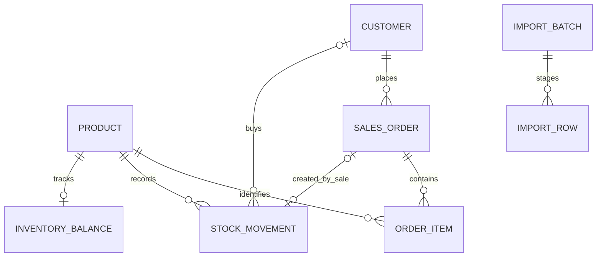

# Final-review schema additions

Verified 19 October 2026. **34 logical tables**, 227 columns across those logical tables: 16 public and 18 reporting. This includes schema_migration; excluding it gives 33 application/support tables. Physical message partitions and views are not additional logical tables.

The prior 28-table reference describes the pre-expansion schema. Existing table definitions are unchanged; six workflow tables were added. The verified raw catalogue is artifacts/final-review-schema.json.

## reporting.inventory_balance

| Column | Type | Nullable | Default |
|---|---|---|---|
| product_id | bigint | NO |  |
| quantity | integer | NO | 0 |
| reorder_level | integer | NO | 10 |
| updated_at | timestamp with time zone | NO | now() |

- PRIMARY KEY (product_id)
- FOREIGN KEY (product_id) REFERENCES reporting.product(product_id) ON DELETE RESTRICT
- CHECK ((quantity >= 0))
- CHECK ((reorder_level >= 0))

## reporting.stock_movement

| Column | Type | Nullable | Default |
|---|---|---|---|
| movement_id | bigint | NO |  |
| product_id | bigint | NO |  |
| kind | text | NO |  |
| quantity_delta | integer | NO |  |
| reference | text | NO |  |
| note | text | NO | ''::text |
| actor | text | NO |  |
| customer_id | bigint | YES |  |
| unit_price | numeric | YES |  |
| order_id | bigint | YES |  |
| posted_on | date | NO |  |
| created_at | timestamp with time zone | NO | now() |

- CHECK ((((kind = 'receipt'::text) AND (quantity_delta > 0) AND (order_id IS NULL) AND (customer_id IS NULL) AND (unit_price IS NULL)) OR ((kind = 'sale'::text) AND (quantity_delta < 0) AND (order_id IS NOT NULL) AND (customer_id IS NOT NULL) AND (unit_price IS NOT NULL) AND (unit_price >= (0)::numeric) AND (unit_price <= 9999999999.99))))
- FOREIGN KEY (customer_id) REFERENCES reporting.customer(customer_id) ON DELETE RESTRICT
- CHECK ((kind = ANY (ARRAY['receipt'::text, 'sale'::text])))
- CHECK ((length(note) <= 500))
- FOREIGN KEY (order_id) REFERENCES reporting.sales_order(order_id) ON DELETE RESTRICT
- UNIQUE (order_id)
- PRIMARY KEY (movement_id)
- FOREIGN KEY (product_id) REFERENCES reporting.product(product_id) ON DELETE RESTRICT
- CHECK ((quantity_delta <> 0))
- CHECK (((length(TRIM(BOTH FROM reference)) >= 1) AND (length(TRIM(BOTH FROM reference)) <= 100)))
- UNIQUE (reference)

## reporting.import_batch

| Column | Type | Nullable | Default |
|---|---|---|---|
| batch_id | uuid | NO | gen_random_uuid() |
| filename | text | NO |  |
| file_sha256 | text | NO |  |
| headers | jsonb | NO |  |
| mapping | jsonb | NO |  |
| mapping_source | text | NO |  |
| actor | text | NO |  |
| state | text | NO | 'preview'::text |
| created_at | timestamp with time zone | NO | now() |
| committed_at | timestamp with time zone | YES |  |

- CHECK ((file_sha256 ~ '^[0-9a-f]{64}$'::text))
- CHECK ((jsonb_typeof(headers) = 'array'::text))
- CHECK ((jsonb_typeof(mapping) = 'object'::text))
- PRIMARY KEY (batch_id)
- CHECK ((state = ANY (ARRAY['preview'::text, 'committed'::text])))

## reporting.import_row

| Column | Type | Nullable | Default |
|---|---|---|---|
| batch_id | uuid | NO |  |
| row_number | integer | NO |  |
| raw | jsonb | NO |  |
| cleaned | jsonb | NO | '{}'::jsonb |
| errors | jsonb | NO | '[]'::jsonb |
| state | text | NO |  |

- FOREIGN KEY (batch_id) REFERENCES reporting.import_batch(batch_id) ON DELETE RESTRICT
- CHECK ((jsonb_typeof(cleaned) = 'object'::text))
- CHECK ((jsonb_typeof(errors) = 'array'::text))
- PRIMARY KEY (batch_id, row_number)
- CHECK ((jsonb_typeof(raw) = 'object'::text))
- CHECK ((row_number > 0))
- CHECK ((state = ANY (ARRAY['valid'::text, 'rejected'::text, 'imported'::text, 'duplicate'::text])))

## reporting.assistant_request

| Column | Type | Nullable | Default |
|---|---|---|---|
| request_id | uuid | NO | gen_random_uuid() |
| actor | text | NO |  |
| prompt | text | NO |  |
| interpretation | jsonb | NO |  |
| sql_text | text | NO |  |
| parameters | jsonb | NO |  |
| source | text | NO |  |
| model | text | YES |  |
| created_at | timestamp with time zone | NO | now() |

- PRIMARY KEY (request_id)
- CHECK (((length(prompt) >= 1) AND (length(prompt) <= 2000)))

## reporting.analysis_run

| Column | Type | Nullable | Default |
|---|---|---|---|
| analysis_id | uuid | NO | gen_random_uuid() |
| actor | text | NO |  |
| start_date | date | NO |  |
| end_date | date | NO |  |
| facts | jsonb | NO |  |
| narrative | text | NO |  |
| source | text | NO |  |
| model | text | YES |  |
| created_at | timestamp with time zone | NO | now() |

- CHECK ((end_date > start_date))
- PRIMARY KEY (analysis_id)

## Design and normalization

stock_movement.movement_id is an identity-generated bigint. The snapshot's column_default field does not describe identity generation; see migration 150 for the complete DDL. Assistant/analysis actor fields contain the authenticated username as evidence, not invented FKs to the broker identity tables. Import state/row counters refer to staged lines; acceptance/rejection is by complete order.

inventory_balance is a transaction-maintained projection keyed by product_id; quantity is deliberately reconciled against the append-only movement ledger. Product labels remain in product, and customer labels remain in customer. Stock movement links its optional resulting sales order through an FK. Import rows use the composite key (batch_id,row_number); raw/cleaned JSON is staging/evidence, while accepted facts are published into existing normalized customer/order/item/product relationships. Assistant and analysis records preserve interpretations/results as evidence; no blanket normal-form claim is made for retained JSON artifacts.

The new view v_inventory joins product metadata, balances and grouped movement sums. post_stock is a stored function invoked through SELECT; the existing submit_run remains a procedure invoked through CALL. Do not call the new function a procedure in the final slides.
