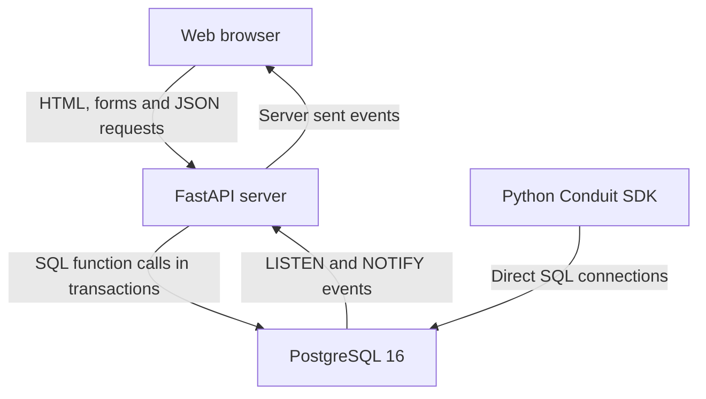
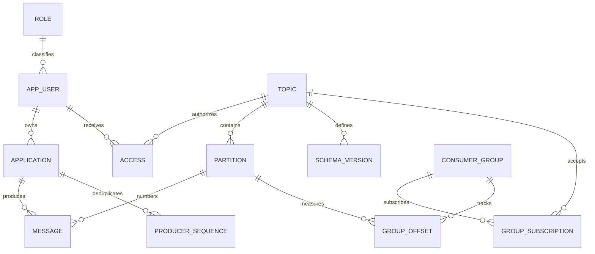
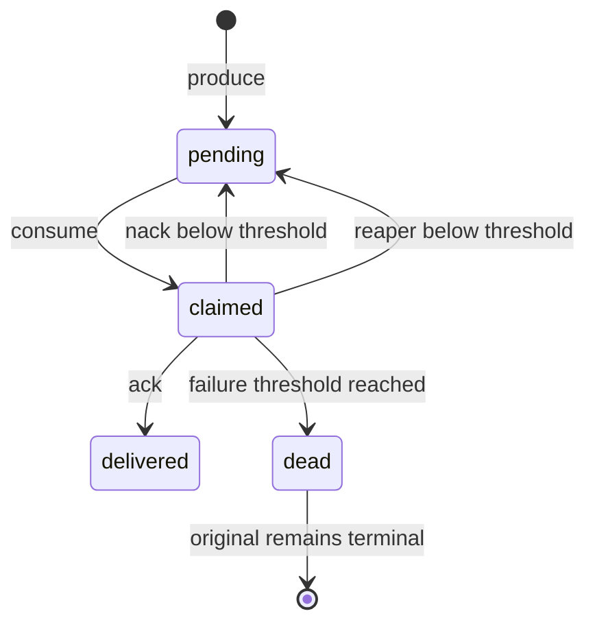

# Conduit project explanation

Reviewed on 13 October 2026 for Team 17. Read this guide first, then [the grading audit](REVIEW_2_READINESS.md) and [the presentation review](REVIEW_2_PRESENTATION_PLAN.md).

Conduit is a PostgreSQL-backed message queue with a web dashboard, an HTTP API, and a Python client. Its strongest academic feature is that the database performs the actual messaging work. The project contains substantial Review 2 material, but some behavior and documentation need correction before a reliable demonstration.

## 1. The problem it solves

Suppose a checkout service needs another service to process an order. If checkout calls the other service directly, checkout depends on that service being available and fast enough. With a queue, checkout stores a message and a worker processes it later. Messages can wait while a worker is busy, and workers can retry failed work.

An example message is:

```json
{"event": "created", "order_id": 42}
```

Conduit stores that JSON in a PostgreSQL row. A worker claims the row, performs work, then acknowledges success. If processing fails, the worker rejects it. After repeated failures, Conduit copies the payload to a dead letter queue for inspection and requeueing.

The shopping services in the seed are illustrative clients. This repository does not implement a complete shopping system, payment gateway, or email delivery service. The broker and its management interface are the project.

## 2. The actual scope

The implementation includes topic management, logical partitions, application registration, topic permissions, required-field payload validation, producer retry deduplication, batch production, concurrent message claiming, acknowledgements, retries, expired-claim recovery, dead letter storage, retention deletion, SQL reporting, audit triggers, and a dashboard.

It runs as one PostgreSQL container and one FastAPI container. There is no implemented broker cluster, replication protocol, custom file storage engine, Kafka server, or independent message fan-out for each consumer group.

The current delivery model is a **shared work queue**. Each message has one global status and one claiming group. When one group delivers it, another subscribed group cannot later consume that same message. Multiple groups are modelled in the schema, but their delivery histories are not independent.

This scope can still make a strong DBMS project. Explain it accurately. Changing it into a Kafka-style stream with independent group delivery would require a meaningful redesign.

## 3. What changed after Review 1

The submitted Review 1 PDF describes a hybrid system: custom append-only message storage and WAL, with six relational tables for metadata. Its performance requirement explicitly avoids synchronous relational operations on the message path.

The implementation now stores messages in PostgreSQL and deliberately performs relational transactions on that path. It uses PostgreSQL WAL instead of a custom WAL. It expands the relational model to 15 logical tables and changes group-to-topic subscriptions from one-to-many to many-to-many.

This is an architectural change, not simply completion of the original design. Its academic rationale is clear: messages, constraints, transactions, locks, indexing, and reporting now demonstrate DBMS concepts directly. Record the revised requirements and ER diagram, and establish whether the evaluator accepts this change. The available assessment does not itself say whether a design change needs approval.

Do not describe Review 1 as failed. The user states Review 1 is complete. Explain the change neutrally as a revised implementation choice.

## 4. Architecture and technologies



PostgreSQL is the storage and business-logic layer. SQL and PL/pgSQL functions produce, claim, settle, and maintain messages. Triggers enforce selected rules, write audit records, and publish notifications. Views calculate operational summaries.

FastAPI authenticates requests, establishes a database identity for app requests, calls SQL functions, and returns results. Admin operations use a separate privileged connection pool. App operations use `conduit_app`, a role subject to row-level security.

The frontend is **Jinja2 templates, HTMX, Alpine.js, Tailwind/DaisyUI, and Chart.js**. It is not React or TypeScript. Jinja builds HTML on the server, HTMX replaces fragments, Alpine handles the Playground interactions, and Chart.js draws charts. Vendor files are stored locally for use without a CDN.

The Python SDK connects directly to PostgreSQL. It does not call the REST API. Consequently, its database credentials and ability to execute arbitrary SQL create a different security boundary from the web API.

`PLAN.md` contains an outdated React architecture diagram. `progress/MILESTONE-06.md` and the actual implementation establish the current frontend.

## 5. The database model

There are 15 logical tables. The schema file also creates eight physical child relations for the partitioned `message` table, giving 23 `CREATE TABLE` statements.

| Table | What a row represents | Why it exists |
|---|---|---|
| `role` | One named role | Avoid repeating role definitions on users |
| `app_user` | A human owner or administrator | Owns applications and selected management objects |
| `application` | A registered producer/consumer application | API key, app type, owner, and revocation status |
| `access` | A user's permission on one topic | Topic permissions for produce, consume, or admin |
| `topic` | A named destination such as `orders` | Retention, size limit, state, and ownership |
| `partition` | A logical stream lane inside a topic | Numbering and next message offset |
| `schema_version` | A version of a topic payload contract | Latest active required-field contract |
| `message` | One stored message | Payload, producer, location, delivery state, and attempts |
| `producer_sequence` | One accepted producer sequence | Retry deduplication independent of time partitioning |
| `consumer_group` | A named worker group | Delivery attempt policy and group state |
| `group_subscription` | One group subscribed to one topic | Resolves the many-to-many relationship |
| `group_offset` | A group's recorded position in one partition | Current maximum acknowledged position |
| `dead_letter_message` | A snapshot of a failed message | Keeps payload and failure information for requeueing |
| `audit_log` | One recorded event | Reports production, delivery, permissions, and selected changes |
| `broker_config` | One named configuration value | Stores settings, though several runtime limits are hardcoded |

Core relationships:



This is a simplified core diagram. Use the schema file as the authority for the remaining relationships, nullable references, and deletion rules.

### Two meanings of partition

A **logical broker partition** is a row in `partition`. The `orders` topic, for example, has four such lanes. Each lane has its own `next_offset` counter.

A **physical PostgreSQL partition** is a child table such as `message_2026_10`. PostgreSQL routes rows into it using `created_at`. It contains messages from multiple topics and logical partitions.

These serve different purposes: logical partitions support routing and numbering, while monthly database partitions support time-based storage management.

### The message location

The API identifies a message by its globally assigned logical `partition_id` and its `msg_offset`. The database primary key also includes `created_at` and `topic_id`, because uniqueness on a partitioned table must include the time partition key.

The produce function allocates offsets to keep logical locations unique during normal operation. The primary key alone does not prevent a direct insert with the same logical location and a different timestamp. Likewise, separate topic and partition foreign keys do not enforce that the selected partition belongs to the selected topic. The distinction matters when claiming that all integrity rules survive arbitrary raw SQL writes.

## 6. The complete message lifecycle

### Produce

1. Authenticate the app and establish its owner identity in the transaction.
2. Find an active topic and check the app is active and permitted to produce by app type.
3. Acquire a transaction advisory lock for the producer sequence.
4. Look in `producer_sequence`. If the sequence already exists for this app, return its original location.
5. Validate the latest active required-field contract and size limit.
6. Pick a logical partition. Keyed messages use a hash. Unkeyed messages choose the lane with the smallest current `next_offset`, breaking ties by partition number.
7. Lock the partition row, read its next offset, and increment the counter.
8. Insert the message and ledger row. Triggers check produce ACL, write the audit record, and issue `NOTIFY`.
9. Commit. The caller receives a message location.

The ledger key is `(producer_app_id, producer_seq)`, **across all topics**. Sequence numbers must be unique per application, not reset for every topic or batch. The same sequence with a different payload still returns the old location; there is no conflict comparison against the original payload.

The separate ledger solves an actual PostgreSQL partitioning problem: including `created_at` in a message uniqueness rule would permit a retry at a later timestamp. Its own unpartitioned primary key catches that retry.

There is currently a 32-bit cast in advisory locking despite a BIGINT sequence interface. This conflicts with the timestamp sequences the web Playground generates; see the readiness audit.

### Consume

The function checks group state, active topic, and subscription. It selects available `pending` rows with `FOR UPDATE SKIP LOCKED`, then updates those selected rows to `claimed` in the same SQL statement. It records the group, sets a visibility deadline, and increments attempts.

`FOR UPDATE` locks selected rows. `SKIP LOCKED` lets other workers skip rows already locked by another transaction. This avoids waiting on those message locks during claiming; it does not remove all locks or all sources of contention.

The query orders by `msg_offset`, not by a unique global sequence. Offsets can tie across logical partitions. The UPDATE's returned rows have no explicit output ordering, so callers should not assume that slicing the returned batch gives a contiguous offset prefix.

### Acknowledge

`ack()` marks matching claimed messages delivered and updates each affected group's partition offset in one transaction. This is a useful atomic multi-table database operation.

However, the offset update takes `max(acked_offset) + 1`. Acknowledging offset 9 while offset 0 remains unfinished records position 10. It does not prove that every earlier message completed. The displayed lag can therefore be misleading.

This also does not make arbitrary business processing exactly once. A worker could send an email, crash before acknowledgement, then send the email again after retry. The current SDK does not expose a transaction API combining arbitrary business updates and acknowledgement. A same-database custom transaction is possible in principle, but the current demos do not implement that business workflow.

### Reject and recover

`nack()` returns an unsuccessful claim to pending while attempts remain below the group's threshold. At the threshold it snapshots the payload in `dead_letter_message` and marks the original message dead.

If a worker disappears without acknowledging, the row stays claimed. `reap_expired_claims()` finds expired claims and either makes them pending or dead-letters them. Timeout alone does not reset the row: somebody must run the reaper.

`requeue_dlq()` produces a new message and marks the DLQ entry requeued. The original dead message remains separate. Its current read of the DLQ row does not lock it, so simultaneous requeues can produce multiple replacements.



Requeue creates a new pending row rather than changing the original dead row back to pending.

## 7. What each DBMS feature contributes

| Feature | Project example | What to explain in the viva |
|---|---|---|
| Primary keys | Composite ledger/subscription/offset keys | Prevent duplicate identities or relationships |
| Foreign keys | Message references topic, app, partition, group | Reject missing referenced objects |
| CHECK constraints | Status, positive retention, nonnegative offsets | Limit legal values |
| UNIQUE constraints | Username, API key, topic name, ACL triple | Protect natural identifiers |
| Transactions | Message insert plus ledger plus offset allocation | Partial failure rolls back the operation |
| Row locks | `partition ... FOR UPDATE` | Concurrent producers cannot allocate the same next offset |
| Advisory locks | Producer retry pair | Serializes attempts using the same deduplication identity |
| SKIP LOCKED | Consume candidate query | Workers claim separate available rows |
| Triggers | Produce audit and monotonic offset guard | Automatically run on matching database writes |
| Functions | `produce`, `consume`, `ack`, `nack` | Centralize broker operations in SQL/PL/pgSQL |
| RLS | Policies on messages and DLQ | Apply identity-based visibility and write checks on the app path |
| Joins | Lag and audit views | Combine normalized records into useful reports |
| Aggregation | Counts by message status | Calculate backlog and outcomes from rows |
| Window functions | Cumulative messages per topic/minute | Compute running totals without collapsing each minute |
| Partial indexes | Pending-only and claimed-only indexes | Concentrate indexes on selected message states |
| BRIN | Timestamp indexes | Compact summaries suited to physically correlated timestamps |
| Materialized view | `mv_topic_stats` | Stores a cached result requiring explicit refresh |
| WAL | PostgreSQL recovery | Database durability mechanism, not a custom implementation |
| LISTEN/NOTIFY | Produce event trigger | Commit-linked notifications refresh parts of the interface |

The schema contains **functions**, not SQL `CREATE PROCEDURE` objects. They meet the assessment's advanced-feature category through its explicit inclusion of functions. There is no need to add artificial procedures just to increase the feature list.

## 8. Navigation through the repository

Read in this order:

1. `README.md` for operation and available demos.
2. `db/sql/00_schema.sql` for entities, constraints, partitioning, and indexes.
3. `db/sql/10_functions.sql` for the broker lifecycle and admin routines.
4. `db/sql/20_triggers.sql` and `30_rls.sql` for enforcement.
5. `db/sql/40_views.sql` for joins, aggregates, and the materialized view.
6. `db/sql/50_seed.sql` for example data and lifecycle exercises.
7. `server/app/api/broker.py`, `auth.py`, and `db.py` for HTTP-to-database calls.
8. `server/app/webui/router.py`, templates, and `static/app.js` for the interface.
9. `client/conduit/broker.py` for the direct Python SDK.
10. `tests/`, `demos/`, and `benchmarks/` for existing verification and recorded evidence.

`progress/` is useful history, but its completion labels and numerical claims are not substitutes for checking the current source. `PLAN.md` is similarly a plan rather than an authoritative implementation description.

## 9. How to explain it in one minute

“Conduit provides asynchronous message processing using PostgreSQL as the broker. Applications publish JSON messages to topics. A database function assigns a partition offset and stores the message with a deduplication ledger in one transaction. Workers claim pending rows with row locking and SKIP LOCKED, then acknowledge or reject them. Triggers record selected events, RLS applies topic access checks on app connections, and SQL views show counts and recorded offsets. The project demonstrates relational design, constraints, joins, functions, indexing, transactions, and database recovery. The current model is a shared work queue with retries.”

## 10. Questions you should be able to answer

**Why PostgreSQL?** It allows the messaging behavior itself to demonstrate DBMS concepts. It also reduces infrastructure for a small queue application. This implementation does not establish performance equivalence with dedicated brokers.

**Why a separate producer ledger?** A partitioned message table's unique key must include its partitioning column. A separate ledger can enforce one accepted sequence per producer without a changing timestamp defeating deduplication.

**What is an offset?** The message's position within one logical partition. `next_offset` is the next number to allocate. The current committed position is the highest acknowledged offset plus one, with the gap limitation described above.

**Why SKIP LOCKED?** Multiple workers can claim available rows while skipping rows another transaction has locked. It is a concurrency technique for a queue.

**What survives a crash?** Committed data is subject to PostgreSQL's durability configuration and WAL recovery. Unacknowledged worker claims require the reaper to become available again. Worker side effects are not automatically deduplicated.

**What does payload validation check?** For topics with a contract, the payload must be a JSON object containing required keys. It does not implement complete JSON Schema type, range, or nested validation.

**What is the view versus materialized view distinction?** A normal view executes its defining query when read. A materialized view stores a result until refreshed. The current dashboard reads the normal views, so the materialized view demonstrates a feature but is not currently the chart data source.

**What does RLS protect?** Rows accessed as `conduit_app` through policies on `message` and `dead_letter_message`, using the identity set by the trusted caller. It does not protect unrestricted admin reads or make a shared database login safe against arbitrary identity spoofing.

**Is it exactly once?** It deduplicates normal producer retries and updates acknowledgement state atomically. Delivery can repeat after a timeout. Arbitrary external processing is not exactly once.

**What must be ready for grading?** Explain one traceable lifecycle, show actual SQL and results for each assessment category, correct the slides, and complete the runtime checks described in the grading audit.
