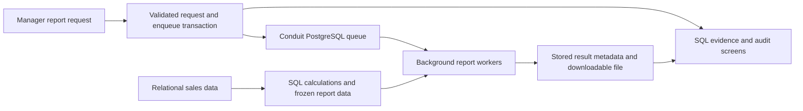

# Conduit reporting project and updated assessment plan

Date: 17 October 2026. Status: proposed scope following the user's selection of report generation. This document does not implement application code, database migrations, AI integration, bulk generators, or a new deck/report. Existing broker implementation and previously verified behavior remain distinct from proposed reporting features.

Implementation update: the user accepted DBMS-first execution and native portability. The backend/native work is now implemented; see [IMPLEMENTATION_STATUS.md](IMPLEMENTATION_STATUS.md) for verified features and results, and [IMPLEMENTATION_PLAN.md](IMPLEMENTATION_PLAN.md) for order and deferred UI/artifact work. The detailed design discussion below records the original proposal.

## Recommended project

**Conduit Asynchronous Business Reporting System**

A manager requests customer statements or sales summaries from a relational sales database. PostgreSQL validates and records the request, Conduit queues its work, SQL calculates the report data, and a background worker produces a real downloadable CSV or HTML/PDF report. The application exposes the exact template SQL, parameters, relevant database relationships, and verified output for each report.

Retain Conduit as the DBMS-backed message broker developed for Review 1. Add a reporting application as its client. The project story is now business data -> SQL report -> queued generation -> downloadable result, with database correctness visible throughout. Avoid expanding into a complete shop, certificate platform, and helpdesk at the same time.

Microsoft's official report-export documentation describes asynchronous export jobs and status polling. It supports the application pattern; this project does not require Power BI or inherit its capabilities. [Power BI export workflow](https://learn.microsoft.com/en-us/power-bi/developer/embedded/export-to).

## Updated assessment authority

The user supplied this new allocation:

| Deliverable | Marks | Planned evidence |
|---|---:|---|
| PPT presentation | 5 | Required contents, readable ER/schema/SQL-output slides, working story |
| Demo and implementation | 5 | Actual requests, generated files, constraints, queries, transactions, failure/recovery |
| Viva | 5 | Explain schema, normalization, SQL, transaction boundaries, queue behavior, limitations |
| Innovation/novelty/additional feature | 2 | Versioned, reproducible report runs with an observable replay experiment |
| Report document | 3 | Required sections, actual code and matching outputs, diagrams, testing, references |
| Total | 20 | Evidence across all five categories |

`C:\Users\asus\Downloads\Guidelines for BCSE302P.docx` was read in full, including its main document and available headers/footers. It contains PPT/report contents, not this numerical mark allocation. It contains no embedded media. Use the user's allocation above and the uploaded contents together as the current planning basis, retaining the earlier Review 2 database criteria as an implementation checklist where compatible.

The guideline title says BCSE302P, while the report title-page example says BCSE302L. Verify the official course code before the final title page; do not silently invent student/faculty details.

## Bounded business scenario

Use a fictional retailer's completed sales records. Four base relations are enough: customer, product, sales order, and order item. The reporting application manages reports over these records; it does not need a checkout or payment processor.

Start with three templates sharing that same schema:

1. **Customer purchase statement**: selected customer's orders, items, quantities, sale-time prices, and period totals. This is the bulk-generation template: one statement per customer.
2. **Sales by product/category**: quantities and sales value in a date range, optionally restricted to top N or groups above a threshold.
3. **Monthly sales summary**: monthly totals, ranking, and optionally a running total through a window function.

Produce CSV plus a readable HTML report initially. Add PDF if needed for the presentation; keep business totals independent of rendering format. A certificate merely repeating a name is a weaker showcase for joins and aggregation. It can be a later template, but should not replace the relational reporting story.

## Proposed architecture and responsibilities

For bulk runs, prepare a persistent batch dataset using set-based SQL, then let workers render individual customer slices. Dataset preparation can itself be queued if it takes noticeable time; do not make the browser wait for an expensive calculation merely to display an accepted request. Treat the batch as preparing until its committed dataset is ready, then enqueue rendering jobs in controlled chunks.

Current Conduit gives each message shared delivery state across groups. Use one rendering topic and one worker pool with two/four independently running processes. Do not promise that multiple groups each receive a copy of the same message. Keep broker acknowledgement separate from the business meaning of completed report generation.

PostgreSQL calculates, validates, joins, aggregates, stores queue/job state, enforces uniqueness, and records audit evidence. Worker code reads a job, renders an actual file, publishes result metadata, and acknowledges completion. It should not duplicate the SQL totals in a second hidden Python calculation.

## Data model to design after scope agreement

Proposed tables below are roles, not final names or migrations. Reuse existing user/application identities and broker tables rather than duplicating them.

| Area | Proposed relation | Purpose and key constraints |
|---|---|---|
| Business data | customer | Unique customer reference, required name |
| Business data | product | Unique SKU, allowed category and nonnegative catalogue price as appropriate |
| Business data | sales_order | Customer FK, required order time, allowed state |
| Business data | order_item | Order/product FKs, positive quantity, nonnegative sale-time unit price; appropriate line identity |
| Reporting | report_template_version | Approved template identifier/version, parameter contract, immutable version identity |
| Reporting | report_run | Batch/requester, template version, validated parameters, preparation/completion state |
| Reporting | report_request | One customer/report job, run and subject references, unique submission identity, allowed state |
| Reporting | report_result | Request FK, unique successful result identity, output location, checksum and completion time |
| Reproducibility | report_dataset | Frozen data for a run/subject, dataset identity/version, retained provenance |

Use typed columns for required relationships, dates, quantities, identities, and states. JSONB can hold validated optional parameters and a frozen report's structured output, but must not hide core relational records merely to avoid joins. A JSONB column alone is not a complete validation contract. Existing Conduit schema validation checks object shape and required keys; domain types/ranges need explicit validation.

Explain functional dependencies for the actual final relations. For example, a product reference determines catalogue metadata, an order reference determines its customer/date, and a line identity determines quantity and sale-time price. The historical sale price is not determined by today's catalogue price. Explain intentionally derived totals/snapshots as retained report artifacts, rather than claiming every redundant value is normalized. Supply a worked 1NF -> 2NF -> 3NF example for the base sales data.

Decide whether a result is unique per request or whether explicit output revisions are supported. Prefer one successful result per immutable request initially. A fresh calculation after source changes should be a new request/run, not an overwrite of its historical predecessor.

## Features required for a complete database demonstration

### Database design, constraints, and CRUD

Show the reporting ER slice and how it attaches to existing Conduit identities/queue records. Provide actual CREATE TABLE definitions and matching inserted records. Demonstrate PK, FK, UNIQUE, NOT NULL, and CHECK with one valid case and controlled rejected cases.

Show INSERT of synthetic business records, SELECT of report rows, UPDATE of a permitted demonstration source record, and DELETE of an unused disposable fixture. Use FK RESTRICT or an explicit safe dependency policy for referenced business rows. Deleting a dummy unused row is different from deleting the audit/history required by reproducibility. Invalid-input tests must prove no invalid rows persisted.

### Queries and outputs

Prepare named questions with short SQL and live results:

| Question | SQL concept |
|---|---|
| Which orders belong to this customer in this month? | WHERE, date range, ORDER BY |
| Which products appear in those orders and at what sale prices? | customer/order/item/product JOIN |
| What is each customer's total purchase value? | SUM(quantity * unit_price), GROUP BY |
| Which customers spent above the selected threshold? | HAVING |
| Which customers have no orders in the period? | NOT EXISTS subquery, or LEFT JOIN with null handling |
| Which products rank highest by sales value? | GROUP BY and ranking/window function |
| How many requests are queued, processing, successful, or failed? | FILTER/count aggregates over authoritative request states |
| Which report failures need attention? | Filtered report/DLQ join or correlated lookup with an explicit stable job identity |

Use fixed test fixtures whose expected totals can be checked independently. Do not count every retry as another customer's purchase or report success.

### Advanced database concepts

* **Procedure**: add a meaningful reporting submission/batch-chunk procedure that validates reporting parameters, creates the required request rows, and enqueues their Conduit jobs using the same transaction/connection. It should not be a renamed wrapper solely for a slide. Current source has functions and no CREATE PROCEDURE routines. The new PPT contents explicitly mention procedures and functions, so plan an actual procedure demonstration. [PostgreSQL CREATE PROCEDURE](https://www.postgresql.org/docs/16/sql-createprocedure.html).
* **Functions**: retain/explain produce, consume, ack/nack and add report data functions only if they simplify a stable report interface.
* **Triggers**: demonstrate existing automatic broker audit and an appropriately scoped reporting-state audit trigger if added. Avoid generating files or calling AI inside a trigger.
* **Views**: create a useful line-value/reporting view or request-status view; show definition and actual output.
* **Materialized view**: optional sales summary with an explicit refresh demonstration. A materialized view alone is refreshable and is not a permanent historical snapshot. [PostgreSQL materialized views](https://www.postgresql.org/docs/16/rules-materializedviews.html).
* **Transaction control**: show successful COMMIT and a controlled failure followed by ROLLBACK. A report request and queue enqueue must persist together or neither. A batch may use several recorded, repeat-safe chunks instead of one unbounded transaction.
* **Indexes**: choose indexes from actual filters/joins, such as customer/date order lookup and order-item order lookup. Show EXPLAIN (ANALYZE, BUFFERS) for read-only report queries. A sequential scan can be correct for a full-dataset aggregate; do not force an index to manufacture a performance claim. [PostgreSQL EXPLAIN](https://www.postgresql.org/docs/16/using-explain.html).

Keep external file generation outside a long-running database transaction. Use deterministic request-based output locations, publish files through a controlled temporary-to-final step, enforce result uniqueness, and make repeat delivery recognize an existing completed result. Coordinate database result publication and ack on the same transaction/connection where feasible. A file write is not rolled back by PostgreSQL, so verify the crash boundaries explicitly rather than claiming end-to-end exactly-once execution.

## The 10,000-report experiment

The user's idea is useful as a measured experiment. It is not yet implemented or benchmarked, and 10,000 is a chosen workload, not proof of scalability by itself.

### Workload and preparation

Use deterministic fictional data with a fixed generator seed. A provisional larger fixture is 10,000 customers, 100,000 sales orders, and 300,000 order lines, producing one customer statement each. Begin much smaller and adjust the fixture to the actual laptop's memory, CPU, disk, and renderer. Generate enough eligible activity to make every intended report meaningful, or explicitly support and count no-activity statements.

PostgreSQL's generate_series can create synthetic row ranges and COPY can import generated rows. Record which method was used and run ANALYZE after bulk loading before plan comparisons. Seeding is different from enqueueing jobs, and neither is evidence that files have been generated. [PostgreSQL generate_series](https://www.postgresql.org/docs/16/functions-srf.html), [COPY](https://www.postgresql.org/docs/16/sql-copy.html), [ANALYZE](https://www.postgresql.org/docs/16/sql-analyze.html).

Use increasing levels, for example 10, 100, 1,000, then 10,000 requests. Use a fixed small worker count and bounded database connection pools, not 10,000 simultaneous database connections. A script submits jobs; workers actually generate distinct outputs tied to distinct request/customer IDs.

### What to measure separately

| Measurement | Meaning |
|---|---|
| Data-load time | Preparing the source fixture |
| Batch dataset calculation time | SQL joins/aggregation and durable snapshot preparation |
| Request/enqueue time | Persisting accepted work; not report completion |
| Queue wait and completion latency | Waiting plus processing, with median/p95 where collected |
| Worker/query/render time | Separates database calculation from output rendering |
| Completed reports per second | Verified results divided by measured processing interval |
| Output count/size | Distinct readable files and corresponding unique result rows |
| Retry/failed/DLQ counts | Reliability outcomes, not successful reports |
| CPU/memory/disk and DB configuration | Environment needed to interpret the run |

Compare one vs two/four workers on identical workloads if time permits. More workers may stop helping because of database, CPU, file I/O, or pool limits; report the result actually observed. Use warm-up and repeated runs, keep equivalent data/configuration, and retain raw logs rather than claiming a multiplier in advance. An optimized set-based preparation path may be compared with per-customer queries only after verifying equal content and accounting for preparation costs.

Prove successful count with unique request/result identities, detect missing requests through an anti-join, and open sampled output files. Correctness tests should cover line details and totals across a controlled known fixture, not just file existence or a green counter.

For a review slot, run 20-100 reports live and show retained evidence from the 10,000-report run. A full 10,000 run can be started only if its measured duration fits the slot. Do not promise completion time before executing it. Prefer one consistent output format for a performance comparison; HTML/CSV and PDF rendering costs differ.

### What PostgreSQL contributes

PostgreSQL handles persisted queue and reporting rows through transactions, indexes, constraints, and the query planner. Its row locking coordinates current Conduit consumers. Set-based grouping can calculate many report subjects together; workers render those committed subject slices. CPU-intensive rendering still happens in application processes. It is therefore inaccurate to attribute all end-to-end report generation speed to PostgreSQL alone.

Keep the main scalability story about database query plans, bounded transactions, bulk data, unique results, and correctness. Queue state and a small worker pool illustrate asynchronous processing without turning the assessment into a distributed-systems project.

## Recommended novelty: versioned, verifiable report runs

Call the additional feature **Report replay and verification**. It is a useful project enhancement, not a claim to have invented a new database technique.

For each run retain the approved template version, validated parameters, frozen report data, requester, timestamps, result identity, and output checksum. A committed report dataset can contain the exact detail rows and aggregates that the renderer consumes. Define which inputs are retained: a totals-only snapshot cannot reproduce missing line-level details.

Faculty-visible experiment:

1. Generate run A and open one customer's statement.
2. Update a permitted source order line in a separate transaction.
3. Replay run A using its retained dataset: historical content stays unchanged.
4. Create run B from current source data: the new content reflects the edit.
5. Show the dataset/template IDs and audit evidence explaining the difference.

For a bulk run, all customer statements must use the same committed prepared dataset if batch-wide consistency is claimed. Prepare that dataset in one consistent database transaction; after commit, rendering workers read it independently. Avoid holding one reporting transaction open during 10,000 file renders.

REPEATABLE READ provides a consistent view inside a transaction. PostgreSQL MVCC snapshots are not automatically permanent historical data, and an exported snapshot cannot simply be reopened after its owner has ended. Retaining just an as-of timestamp cannot recreate source values that were overwritten or deleted. Persist the required dataset rather than promising unsupported time travel. [PostgreSQL transaction isolation](https://www.postgresql.org/docs/16/transaction-iso.html), [snapshot synchronization](https://www.postgresql.org/docs/16/functions-admin.html#FUNCTIONS-SNAPSHOT-SYNCHRONIZATION).

A checksum detects changes relative to the retained file/record; it does not by itself prove that the underlying SQL was correct or authenticate a document against an attacker who can replace both checksum and file. Define replay as equivalent report content, not necessarily byte-identical PDF files unless rendering metadata and environment are controlled.

## Optional AI addition

If an AI feature is desired after core correctness, add **natural-language report selection**:

User: "Show the five products with highest sales last month."

Model output: a recognized report template, validated date range, and top_n value. The application selects an approved parameterized SQL template, applies ordinary user permissions and limits, displays the SQL/parameters for inspection, then submits the ordinary report request. The model does not calculate authoritative totals or execute arbitrary SQL.

Store the original request, selected template version, and accepted parameters for explanation. Reject unsupported requests rather than fabricating a report. Date interpretation uses an explicit application timezone/reference date. Keep a normal report form available when no model is configured. A rule-based fallback must be labelled as such, not presented as a live AI response.

This addition complements inspectable database queries, but API/network/model dependencies and interpretation tests add work. SQL templates and bound parameters remain responsible for database execution. [OWASP SQL injection prevention](https://cheatsheetseries.owasp.org/cheatsheets/SQL_Injection_Prevention_Cheat_Sheet.html).

Choose the replay feature first for the two novelty marks. AI is optional enrichment, not a requirement in the uploaded document. Do not spend the core PPT/demo/viva budget on an unreliable chatbot or claim an unimplemented AI capability.

## Live demonstration and testing

An approximately 8-10 minute sequence, adjustable to the actual slot:

1. Explain the business request and architecture; trace one report ID.
2. Show base ER relationships and a short JOIN/aggregate with its output.
3. Submit with worker paused, show pending data, start worker, download a real report.
4. Show a rejected constraint/parameter case and a successful CRUD operation on disposable data.
5. Show a procedure call, view, trigger audit, and COMMIT/ROLLBACK evidence.
6. Replay an old run after editing source data, then show a new run with changed content.
7. Show the retained bulk-run results and one real failure/retry/redrive if time allows.

Do not attempt every feature live if it obscures the story. Prepare readable query-output screenshots and an evidence appendix, with live execution of the most meaningful cases.

Tests to retain: known sales totals; customers without orders; invalid date/range/FK/quantity cases; request-plus-enqueue rollback; repeat submission; repeated worker delivery without duplicate successful result; two-worker distinct claims; worker failure before and after result publication; frozen run replay after source update/delete as allowed; missing/unreadable file handling; authoritative batch counts. SQL status counts are stronger than relying solely on the currently faulty offset-derived lag metric.

Previously confirmed broker defects in RUNTIME_VERIFICATION.md remain prerequisites: timestamp sequence overflow, dashboard counts, DLQ web isolation, seeded administrator grant, and out-of-order acknowledgement/lag. Passing existing tests did not cover these. Fix and verify the relevant paths before new reporting completion/permission claims.

## Required PPT contents and proposed evidence

| Uploaded guideline section | What our eventual slides must contain |
|---|---|
| Title | Conduit title, reporting demonstration, correct team/course details |
| Abstract and problem statement | Reliable, inspectable report generation from relational business data |
| Objectives and scope | SQL correctness, async jobs, repeatable historical reports; explicit boundary |
| Architecture/workflow | Manager -> database request/queue -> worker -> output |
| ER diagram | Business/reporting slice, with broker relationship/context |
| Relational schema and normalization | Real keys and dependencies; worked normalization and snapshot tradeoff |
| Database implementation | PostgreSQL, CREATE TABLE, PK/FK/UNIQUE/NOT NULL/CHECK, INSERT examples, SQL and outputs |
| Advanced concepts | Actual procedure, functions, triggers, view, COMMIT and ROLLBACK |
| Screenshots/demonstration | Form, queued work, output, SQL evidence, replay |
| Testing/results | Known expected vs observed results and measured bulk experiment |
| Conclusion/future enhancement | Completed scope and honest next steps |
| References | Uploaded assessment and primary technical sources |

Slide count is not specified in the uploaded guideline. Fit this content to the actual allotted time rather than inventing a compulsory number of slides.

## Required report contents and evidence

Follow the uploaded order: (1) title and student/register/course/faculty details, (2) introduction/purpose, (3) objectives, (4) software requirements, (5) database design with ER/attributes/keys/relationships, (6) database creation and sample INSERT data, (7) operations with matching code and outputs, (8) applicable advanced features, (9) structure/data/query/application screenshots, (10) conclusion, (11) references.

Use the report's database-operations section for SELECT, INSERT, UPDATE, DELETE, JOIN, aggregates, and subqueries. Add normalization within database design and test/bulk-run evidence within operations/results or a clearly named subsection without losing required content. Keep fonts, headings, alignment, and spacing clear as requested. Generate screenshots from the final verified source and dataset; do not retain old inaccurate performance/feature claims.

## Viva preparation

The student should be able to explain why these are separate tables, what each key protects, a real 3NF decomposition, INNER vs LEFT JOIN, WHERE vs HAVING, the difference between a function and procedure, what audit triggers do, where COMMIT/ROLLBACK applies, why the chosen index helps a particular predicate, what refresh changes in a materialized view, and why a retained dataset makes historical report content reproducible.

Also explain: the worker performs rendering; PostgreSQL performs the data operations; acknowledgement is not proof a user downloaded a file; retries require result idempotency; a queue keeps accepted work while a worker is unavailable; two worker processes share work rather than each receiving a copy.

## Implementation priorities after agreement on this blueprint

1. Correct the relevant existing broker defects; preserve its identity and existing work.
2. Implement a small sales fixture and one complete customer-statement template, including relational constraints and transaction-safe submission.
3. Add SQL evidence and real CSV/HTML output with repeat-safe completion.
4. Add the two other reports, controlled CRUD examples, a procedure/view/audit evidence, and the replay feature.
5. Generate and measure bulk data/reports gradually, retaining correctness and performance evidence.
6. Add optional bounded AI only if the core project is stable.
7. Prepare PPT, report, and viva notes around the verified final implementation, following the updated guideline contents and 20-mark split.

Nothing in this proposal predicts a mark, guarantees a runtime, or claims the reporting features have already been implemented. Further primary-source novelty notes are in REPORTING_NOVELTY_RESEARCH.md.
